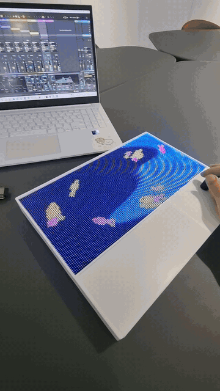

# Patternflow in the field — cases, and the code they ran

[Patternflow](https://github.com/engmung/Patternflow) is an open-source LED panel with four knobs that plays generative patterns. This repository is where its outings are kept: each time it goes somewhere — an exhibition, an installation, an experiment — what ran there is put here whole, so that someone else can read it, rebuild it, or take a piece of it.

**One folder a case.** Each stands by itself: its own README, its own code, firmware, tools and notes, and its own word on licences. Nothing in one case needs another.

| Case | When | What it is | Folder |
|---|---|---|---|
| **Anbu** — patterns after six artists' works, played as light and sound | October 2026, Seoul | One panel at a group show by six visually impaired artists. Visitors turn the knobs; each pattern has its own sound in Ableton Live. With the patterns, the panel firmware, a second board (FlowLocal) and the Live set. | [`exhibition_2026/`](exhibition_2026/) · [한국어](exhibition_2026/README.ko.md) |
| **Ensemble** — many panels played as one | November 2026 – | A hub and eight or more panels on its Wi-Fi. Turn a knob on one and the others follow, at once or as a wave across the room. A browser console lays the room out in 2D and 3D, puts community patterns on every panel, records and edits shows, and wires MIDI to the panels with nodes. | [`ensemble/`](ensemble/) (in Korean; the console is in English) |

  

## How the cases relate

Ensemble grew out of Anbu. At the show a second board, FlowLocal, ran the Wi-Fi and passed one panel's MIDI to a laptop; in Ensemble that board became the hub, and one panel became a room of them. The two share ideas and no files: each folder still builds and runs alone.

## Adding a case

A new folder at the top (`<name>_<year>` for an event, a plain name for something that keeps growing), with a README that says what it was, what is in the folder and how to run it; then a row in the table above, and what the folder keeps out of git under its own heading in `.gitignore`.

## Licences

Code is MIT; documents, media, patterns and the Live set are CC BY-SA 4.0, and the six artists' patterns ask for credit to the artist as well. The details are per case: [`LICENSE.md`](LICENSE.md).
