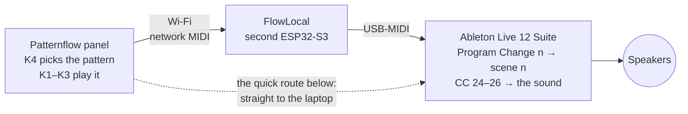

# Patternflow at *Anbu* — patterns after six artists' works, played as light and sound (Seoul, 2026)

  

<!-- YOUTUBE: https://youtube.com/shorts/zsmQVr4Ru4c -->

▶ <a href="https://youtube.com/shorts/zsmQVr4Ru4c"><b>Watch it with sound on YouTube</b></a> · or the <a href="media/demo-720p.mp4">85 s MP4</a> (portrait, 21 MB)

At ***Anbu — Asking After the Unseen*** (안부 — 보이지 않는 안부를 묻다), a group show by six visually impaired artists in Seoul (3–9 October 2026), Patternflow was one interactive corner. Visitors played LED patterns made after the artists' works on a [Patternflow](https://patternflow.work) panel. **One knob picks the pattern, the other three play it, and the sound follows the knobs**: every knob move also goes to Ableton Live as MIDI, so each move is heard as well as seen.

The artists: **Bak Hwan** 박환 · **Choe Gyeong-eun** 최경은 · **Han Yeong-hui** 한영희 · **Heo Eun-bin** 허은빈 · **Jeong Eun-gyo** 정은교 · **Yu Jin** 유진. Organised by **Ablind** (에이블라인드), supported by the **Korea Arts Management Service** (KAMS, 예술경영지원센터). Patternflow and this setup by **Seunghun Lee**. [Credits](#credits).

<table>
  <tr>
    <td width="50%"></td>
    <td width="50%"></td>
  </tr>
  <tr>
    <td>At the show: visitors play the patterns. On the wall, works by Heo Eun-bin and Yu Jin.</td>
    <td>The whole rig: panel, FlowLocal board (left, bare), laptop with Live.</td>
  </tr>
</table>

This repo holds everything that ran there: the six patterns, the panel firmware, the firmware of a second board (FlowLocal), and the Live set with its Max for Live device.

After works by Bak Hwan, Choe Gyeong-eun, Han Yeong-hui, Heo Eun-bin, Jeong Eun-gyo and Yu Jin. To play them in a browser with no hardware, download the repo and open <a href="patterns/preview.html"><code>patterns/preview.html</code></a>.

## How it works

- A pattern change sends **Program Change *n***. A small Max for Live device in the set fires scene *n*, so each work has its own sound.
- Turning K1 / K2 / K3 sends **CC 24 / 25 / 26** on channel 1. Ordinary MIDI mappings in the set turn those into filter, grain, reverb and volume moves.
- At the show a second board, **FlowLocal**, ran the Wi-Fi hotspot and passed the MIDI to the laptop over USB, so the laptop needed no Wi-Fi and no driver. You can leave it out: the quick route below sends the MIDI straight to the laptop.

## What you need

- A **Patternflow** panel ([build it](https://github.com/engmung/Patternflow)). Run it on 5 V through the **J4 screw terminal only, never over USB-C**: one board powered over USB-C smoked at the connector. USB is only for flashing, with the DevKit off the board.
- A computer with **Chrome or Edge** and a USB data cable, to flash the panel.
- A 2.4 GHz Wi-Fi network that the panel and the laptop can share (not a guest network: those keep devices apart).
- A laptop with **Ableton Live 12 Suite**, 12.4 or newer. It must be Suite: the set uses Max for Live and Suite's instruments and packs. Live's free 30-day trial is Suite, but this set has not been tried with it. And speakers.
- Network MIDI on the laptop. macOS has it built in; on Windows, install the free [rtpMIDI](https://www.tobias-erichsen.de/software/rtpmidi.html).
- *Optional, as at the show:* a second board, an **ESP32-S3-DevKitC-1 N16R8**, for FlowLocal.

The show ran with FlowLocal on a Windows 11 laptop. The quick route below (no FlowLocal) and macOS were not tested there.

## Make it

### 1. Flash the panel in the browser

1. Open **[patternflow.work/flash](https://patternflow.work/flash)** in Chrome or Edge.
2. Unplug the 5 V from J4 and take the ESP32-S3 DevKit off the panel board, as in the Patternflow build guide. Plug the DevKit's **USB** jack (not the one labelled COM or UART) into the computer.
3. Click the install button and pick the board's port. When the uploader asks for Wi-Fi, give it the network the laptop is on. Then put the DevKit back on the panel board and power the panel through J4.
4. Use the **Audio edition**, the one with network MIDI. If the uploader offers editions, pick it there; otherwise switch to it in one click over Wi-Fi, keeping your patterns ([Patternflow editions](https://github.com/engmung/Patternflow/blob/main/docs/EDITIONS.md)).

There is nothing to install and nothing to build. The Audio edition sends the same kinds of messages as the show's panel: a Program Change on every pattern change and CC 24–27 from the four knobs.

> The uploader installs Patternflow as it ships, not the show's own build. That build had the six patterns built in, K4 set to switch between them, and each knob's sound locked to the picture. You build it from source: [full guide → Build it](docs/full-guide.en.md#build-it-step-by-step). Its ready-made images are not published, because they contained the venue's Wi-Fi password.

### 2. Connect the panel to the laptop

1. **On the laptop**, start a network MIDI session called **Patternflow** that lets anyone connect.
   - macOS: open *Audio MIDI Setup* → Window → *Show MIDI Studio* and double-click **Network**. Under *My Sessions* click **+**, name the session **Patternflow**, tick it, and set *Who may connect to me* to **Anyone**.
   - Windows: open rtpMIDI and do the same (**+** under *My Sessions*, name, tick, *Who may connect to me*: **Anyone**). If Windows asks whether rtpMIDI may use the network, allow it.
   - The session's **Port** must be **5004**, the default. If another session already uses 5004, delete it first: the panel calls port 5004 only.
2. **On the panel**: in the laptop's browser open `http://patternflow.local/midi`. If that does not open, use `http://<panel-ip>/midi`; your router's list of connected devices shows the panel's address. Make sure MIDI is on and the knobs are on **Knob value** (the default, not *Relative steps*), and click **Use this computer**. Optional: **Sensitivity ×4** gives the show's feel, about 32 detents from end to end.
3. **Check**: within about 20 seconds the panel appears in the session's participant list. From now on it connects about 20 seconds after each start. If the laptop's address on the network changes, click **Use this computer** again.

### 3. Open the Live set

New to Live? Read the two-minute primer first: [full guide → Open the Live set](docs/full-guide.en.md#4-open-the-live-set). Its numbered steps are for the FlowLocal route; on the quick route, follow the steps below.

1. **Download this repo**: on GitHub, *Code → Download ZIP*, then unzip it. The set needs its whole folder, because its scene device lives inside it.
2. Install the packs: in Live's browser open **Packs** and download **Mood Reel**, **Drone Lab** and **Granulator III** (the set's samples come from them). Then open `set Project/set.als` from the unzipped folder.
3. **Settings → Audio**: pick your speakers. **Settings → Link, Tempo & MIDI**: set the **Patternflow** In port to **Track on** and **Remote on** (on macOS Live may list it as *Network (Patternflow)*). Leave the **Patternflow** Out port all **off**. Set **Takeover Mode** to **None**.
4. Click the leftmost track, `1-MIDI`. Set its MIDI From to **Patternflow / All Channels**, MIDI To to **No Output** and Monitor to **In**. Nothing may go back to the panel, because it acts on MIDI it receives.
5. Set MIDI From to **No Input** on the scene tracks numbered 1, 2, 3, 5 and 6 (`1.은행나무`, `2.괘짝`, `3.산`, `5.기하학`, `6.물고기`), so a knob press cannot play them. Leave track 4 (`4.도마뱀`) as it is.
6. On the **PF Exhibit Scenes** device (it is on `1-MIDI`), click **Autostart** so it lights. Then save the set.
7. Click the ▶ of the second scene from the top (Live labels it 2). If you hear a slow drone, the sound side works; stop it with ■ *Stop All Clips*. Now change the pattern on the panel: Live's scene follows.

Patternflow as it ships does not resend its pattern when it connects. After restarting Live or the panel, change the pattern once and Live catches up.

### 4. Play

At the show, **K4 changed the pattern**, and Live's scene with it. Visitors played only the **other three knobs, K1–K3**. Each one changes the picture and the sound together, and each does something different in every pattern. Turn them and find out.

On your web-flashed panel, change patterns the way you always do, and Live follows: pattern *n* fires scene *n*, counting from 0 at the top. Your patterns 1, 2, 3, 5 and 6 get the show's sounds, whatever those patterns are. Patterns 0, 4 and 7 are silent (scene 4 plays only the footstep notes the show's build sends), and from 8 up Live stays where it was. K1–K3 shape the sound. Here all four knobs play the pattern; K4's CC 27 is not mapped in the set.

Every knob, CC and range, picture and sound side by side: [full guide → MIDI map](docs/full-guide.en.md#midi-map).

## Going further

- **[The full guide](docs/full-guide.en.md)**: the setup exactly as it ran at the show, with both boards (FlowLocal too) built from source, every track and mapping, the staff monitor, a first-run checklist and troubleshooting.
- [Live and Max for Live in depth](ableton/README.en.md) · [what the knobs do in each pattern](PATTERN_KNOBS.en.md) · [the show's install and operations notes](docs/setup-notes.en.md) · [the gallery staff card](STAFF_CARD.en.md)
- This repo is a worked example of what Patternflow + sound can do, not a product. A free, lightweight Patternflow tool for sound/MIDI is planned separately.
- **Korean originals.** Every document was first written in Korean, and the Korean files are kept as they were: [`README.ko.md`](README.ko.md) and the files without `.en`. Where code or the Korean docs say `README.md`, they mean `README.ko.md`.

## Credits

**The artists.** Seunghun Lee made each pattern after one artist's work in the show. The works themselves are the artists' own and are not in this repository.

| Artist | Their work in the show (from the press) | The pattern (K4 order) |
|---|---|---|
| **Bak Hwan** 박환 | mountains and waterfalls in earth, thread, denim scraps and bark | 1 · a tree with golden leaves in the wind |
| **Choe Gyeong-eun** 최경은 | ceramics that start from the six dots of braille | 2 · a wooden chest whose doors open on flowers |
| **Han Yeong-hui** 한영희 | cosmos flowers, the road to Jebudo, the South Sea | 3 · a green mountain, clouds and flowers in the wind |
| **Heo Eun-bin** 허은빈 | clay shapes built and painted on canvas; characters such as *Umbrella Rabbit* (우산토끼) and a lizard | 4 · a walking lizard |
| **Jeong Eun-gyo** 정은교 | fish scales in hanji and silicone on black braille paper | 5 · round shapes that drift together into a 3 × 3 grid |
| **Yu Jin** 유진 | afterimages of the sea in glow-in-the-dark paint | 6 · fish swimming in a sea current |

**The exhibition.** *안부 — 보이지 않는 안부를 묻다* / ***Anbu — Asking After the Unseen*** (*안부* is a greeting that asks how someone is). A group show by six visually impaired artists on nature and relationships: 40 works, 25 of which visitors could touch. 3–9 October 2026, free entry, at Gallery 1, Modu Art Space (모두미술공간 전시실1), Seoul Square annex 5F, Jung-gu, Seoul. Organised by **Ablind** (에이블라인드), CEO **Yang Dream** (양드림), with support from the 2026 early-stage arts startup programme of the **Korea Arts Management Service** (KAMS, 예술경영지원센터).

**Patternflow** by **Seunghun Lee**: the panel and its firmware, the pattern code (the files name `@engmung` as their author), the FlowLocal exhibition build, the Live set and the Max for Live device. FlowLocal grew out of the FlowLocal show appliance ([SimonePDA/flowlocal](https://github.com/SimonePDA/flowlocal)).

Names are given family name first. The English spellings are our own romanisation (Revised Romanization of Korean), not confirmed by the artists; the Korean names are the reference, and corrections are welcome. More, with sources: [`CREDITS.md`](CREDITS.md).

## Licences

- Code (the Max for Live device, the tools, the firmware patch, FlowLocal): **MIT**.
- Documentation, the Live set, and the photos and video: **CC BY-SA 4.0**. The artists' works visible in the photos are not licensed.
- The six patterns: **CC BY-SA 4.0, with credit to each artist**. Ablind, the organiser, allowed Seunghun Lee to use the exhibition's work freely, and the patterns are shared on these terms. The licence covers only the pattern code and the pictures it draws; the artists' original works remain theirs and are not licensed here. Ready-made credit lines: [`CREDITS.md`](CREDITS.md#how-to-credit-a-pattern-when-you-reuse-it).

Artists or their representatives who want something changed can open an issue in this repository. Details for each folder: [`LICENSE.md`](LICENSE.md).
