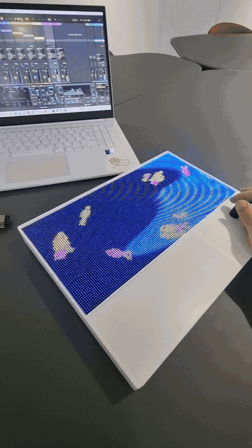
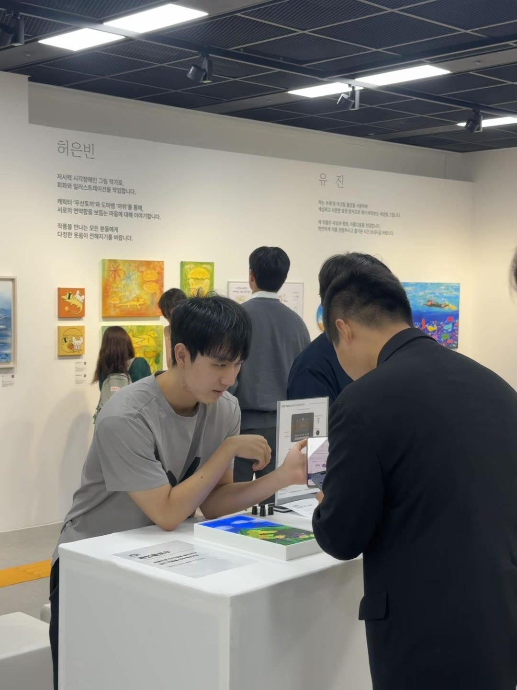
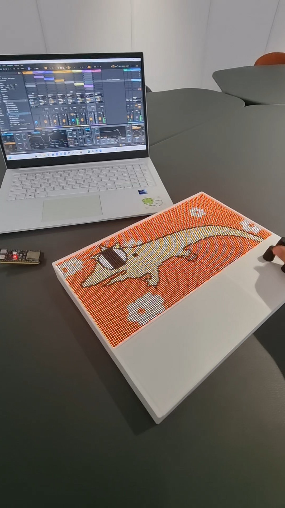
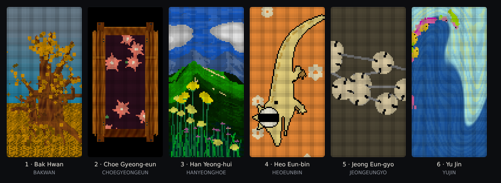
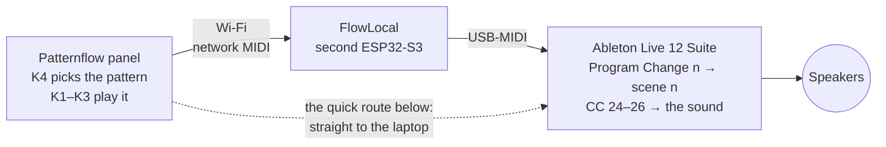

# Patternflow at *Anbu* — patterns after six artists' works, played as light and sound (Seoul, 2026)

  

<!-- YOUTUBE: https://youtube.com/shorts/zsmQVr4Ru4c -->

▶ <a href="https://youtube.com/shorts/zsmQVr4Ru4c"><b>Watch it with sound on YouTube</b></a> · or the <a href="media/demo-720p.mp4">85 s MP4</a> (portrait, 21 MB)

At ***Anbu — Asking After the Unseen*** (안부 — 보이지 않는 안부를 묻다), a group show by six visually impaired artists in Seoul (3–9 October 2026), Patternflow was one interactive corner. Visitors played LED patterns made after the artists' works on a [Patternflow](https://patternflow.work) panel. **One knob picks the pattern, the other three play it, and the sound follows the knobs**: every knob move also goes to Ableton Live as MIDI, so each move is heard as well as seen.

The artists: **Bak Hwan** 박환 · **Choe Gyeong-eun** 최경은 · **Han Yeong-hui** 한영희 · **Heo Eun-bin** 허은빈 · **Jeong Eun-gyo** 정은교 · **Yu Jin** 유진. Organised by **Ablind** (에이블라인드), supported by the **Korea Arts Management Service** (KAMS, 예술경영지원센터). Patternflow, the six patterns and this setup by **Seunghun Lee**; the works they follow are the artists' own. [Credits](#credits).

<table>
  <tr>
    <td width="50%"></td>
    <td width="50%"></td>
  </tr>
  <tr>
    <td>At the show: the Patternflow table, with works by Heo Eun-bin (left) and Yu Jin (right) on the wall behind.</td>
    <td>The whole rig: panel, FlowLocal board (left, bare), laptop with Live.</td>
  </tr>
</table>

This repo holds everything that ran there: the six patterns, the panel firmware, the firmware of a second board (FlowLocal), and the Live set with its Max for Live device.

After works by Bak Hwan, Choe Gyeong-eun, Han Yeong-hui, Heo Eun-bin, Jeong Eun-gyo and Yu Jin. To play them in a browser with no hardware, download the repo and open <a href="patterns/preview.html"><code>patterns/preview.html</code></a>.

## How it works

- A pattern change sends **Program Change *n***. A small Max for Live device in the set fires scene *n*, so each work has its own sound.
- Turning K1 / K2 / K3 sends **CC 24 / 25 / 26** on channel 1. Ordinary MIDI mappings in the set turn those into filter, grain, reverb and volume moves.
- At the show a second board, **FlowLocal**, ran the Wi-Fi hotspot and passed the MIDI to the laptop over USB, so the laptop needed no Wi-Fi and no driver. You can leave it out: the quick route below sends the MIDI straight to the laptop.

## What you need

- A **Patternflow** panel ([build it](https://github.com/engmung/Patternflow)), powered with 5 V through the **J4 screw terminal only, never over USB-C**: one board smoked at the connector.
- A computer with **Chrome or Edge** and a USB data cable, to flash the panel.
- A 2.4 GHz Wi-Fi network that the panel and the laptop share (not a guest network: those keep devices apart).
- A laptop with **Ableton Live 12 Suite**, 12.4 or newer (Suite for Max for Live; the free 30-day trial is Suite, but untried with this set), network MIDI (built into macOS; on Windows the free [rtpMIDI](https://www.tobias-erichsen.de/software/rtpmidi.html)), and speakers.
- *Optional, as at the show:* a second board, an **ESP32-S3-DevKitC-1 N16R8**, for FlowLocal.

The show ran with FlowLocal on Windows 11. The quick route below has not been tested end to end, and macOS was not tested.

## Make it

### 1. Flash the panel in the browser

Already running the Audio edition, v0.5.0 or newer? Skip to step 2.

1. Unplug the 5 V from J4 and take the ESP32-S3 DevKit off the panel board. Plug the DevKit's **USB** jack (not the one labelled COM or UART) into the computer.
2. Open **[patternflow.work/flash](https://patternflow.work/flash)** in Chrome or Edge, click the install button and pick the board's port. Choose the **Audio edition**, the one with network MIDI, if the uploader offers it; otherwise switch to it afterwards over Wi-Fi ([Patternflow editions](https://github.com/engmung/Patternflow/blob/main/docs/EDITIONS.md)). When it asks for Wi-Fi, give it the laptop's network.
3. Unplug the USB cable, put the DevKit back and power the panel through J4. Never connect USB and J4 at the same time.

Nothing to build. The Audio edition sends the same kinds of messages as the show's panel: a Program Change on every pattern change and CC 24–27 from the four knobs.

> This is Patternflow as it ships, not the show's build, which had the six patterns built in, K4 switching between them, and each knob's sound locked to the picture. That one you build from source: [full guide → Build it](docs/full-guide.en.md#build-it-step-by-step). Its ready-made images held the venue's Wi-Fi password and are not published.

### 2. Connect the panel to the laptop

1. **Laptop**: create a network MIDI session named **Patternflow**, on port **5004** (the default; the panel calls 5004 only), with *Who may connect to me* set to **Anyone**. macOS: *Audio MIDI Setup* → Window → *Show MIDI Studio*, double-click **Network**, **+** under *My Sessions*. Windows: rtpMIDI, **+** under *My Sessions*; let it through the firewall.
2. **Panel**: in the laptop's browser open `http://patternflow.local/midi`, or `http://<panel-ip>/midi` (your router lists the address). Check that MIDI is on and the knobs are on **Knob value** (the default, not *Relative steps*), then click **Use this computer**. *Sensitivity ×4* makes each knob's CC cross its range in about 32 detents, as at the show.
3. **Check**: within about 20 seconds the panel shows up in the session's participant list. It reconnects about 20 seconds after each start; if the laptop's address changes, click **Use this computer** again.

### 3. Open the Live set

New to Live? Read the two-minute primer first: [full guide → Open the Live set](docs/full-guide.en.md#4-open-the-live-set) (its numbered steps are for FlowLocal; on the quick route, use these).

1. **Download this repo** (*Code → Download ZIP*) and unzip it. The set needs its whole folder: its scene device lives inside it.
2. In Live, signed in to your Ableton account, open the browser (`Ctrl`/`Cmd` + `Alt` + `B`) → **Packs** and install **Mood Reel** and **Drone Lab** (the set's three samples) and **Granulator III** (the instrument on tracks 1 and 2; if it is not listed, download it from your Ableton account). Then open `set Project/set.als`.
3. **Settings → Audio**: pick your speakers. **Settings → Link, Tempo & MIDI**: the **Patternflow** In port **Track on** and **Remote on**, its Out port all **off** (macOS may list it as *Network (Patternflow)*). **Takeover Mode: None**.
4. Click the leftmost track, `1-MIDI`: MIDI From **Patternflow / All Channels**, MIDI To **No Output**, Monitor **In**. Nothing may go back to the panel, because it acts on MIDI it receives.
5. On scene tracks 1, 2, 3, 5 and 6 (`1.은행나무`, `2.괘짝`, `3.산`, `5.기하학`, `6.물고기`) set MIDI From to **No Input**, so a knob press cannot play them. Leave track 4 (`4.도마뱀`) as it is.
6. On the **PF Exhibit Scenes** device on `1-MIDI`, switch **Autostart** on, then save the set. It now opens on scene 1 and plays.
7. **Test**: click ▶ on the second scene from the top (Live labels it 2). A slow drone means the sound works; stop it with ■ *Stop All Clips*. Then step the panel to its pattern 1 or 2: Live's MIDI *In* light flashes, the device's top line reads `PC n ch1 -> n: …`, and that scene plays.

### 4. Play

At the show, **K4 changed the pattern**, and Live's scene with it. Visitors played only the **other three knobs, K1–K3**. Each one changes the picture and the sound together, and differently in every pattern. Turn them and find out.

On a web-flashed panel, change patterns the way you usually do: pattern *n* fires scene *n*, counting from 0 at the top. Patterns 1, 2, 3, 5 and 6 get the show's sounds. Patterns 0, 4 and 7 are silent (track 4's sound was the show build's footstep notes), and from 8 up Live stays where it was. K4's CC 27 is not mapped.

Every knob, CC and range: [full guide → MIDI map](docs/full-guide.en.md#midi-map).

<b>Not working?</b>

- **The panel never joins the session.** On Windows, set this Wi-Fi to *Private* or allow rtpMIDI on public networks too. On macOS, allow the browser's local-network prompt. Panel and laptop must be on the same network, not a guest one.
- **It stopped after a drop** (laptop asleep, a Wi-Fi gap). Patternflow as it ships can take about 70 seconds to come back, and sometimes stops calling until it restarts. Not back after 90 seconds, or listed while Live's MIDI *In* light stays dark when you turn a knob? Power-cycle the panel.
- **After restarting Live or the panel, Live is on the wrong scene.** Patternflow as it ships does not resend its pattern when it connects. Change the pattern once and Live catches up.
- More: [full guide → Troubleshooting](docs/full-guide.en.md#troubleshooting).

## Going further

- **[The full guide](docs/full-guide.en.md)**: the setup exactly as it ran at the show, with both boards (FlowLocal too) built from source, every track and mapping, the staff monitor, a first-run checklist and troubleshooting.
- [Live and Max for Live in depth](ableton/README.en.md) · [what the knobs do in each pattern](PATTERN_KNOBS.en.md) · [the show's install and operations notes](docs/setup-notes.en.md) · [the gallery staff card](STAFF_CARD.en.md)
- This repo is a worked example of what Patternflow + sound can do, not a product. A free, lightweight Patternflow tool for sound/MIDI is planned separately.
- **Korean originals.** Every document was first written in Korean, and the Korean files are kept as they were: [`README.ko.md`](README.ko.md) and the files without `.en`. Where code or the Korean docs say `README.md`, they mean `README.ko.md`.

## Credits

**The artists.** Seunghun Lee made each pattern after one artist's work in the show. The works themselves are the artists' own and are not in this repository.

| Artist | Their work in the show (from the press) | The pattern (K4 order) |
|---|---|---|
| **Bak Hwan** 박환 | mountains and waterfalls in earth, thread, denim scraps and bark | 1 · a tree with golden leaves in the wind |
| **Choe Gyeong-eun** 최경은 | ceramics that start from the six dots of braille | 2 · a wooden chest whose doors open on flowers |
| **Han Yeong-hui** 한영희 | cosmos flowers, the road to Jebudo, the South Sea | 3 · a green mountain, clouds and flowers in the wind |
| **Heo Eun-bin** 허은빈 | clay shapes built and painted on canvas; characters such as *Umbrella Rabbit* (우산토끼) and a lizard | 4 · a walking lizard |
| **Jeong Eun-gyo** 정은교 | fish scales in hanji and silicone on black braille paper | 5 · round shapes that drift together into a 3 × 3 grid |
| **Yu Jin** 유진 | afterimages of the sea in glow-in-the-dark paint | 6 · fish swimming in a sea current |

**The exhibition.** *안부 — 보이지 않는 안부를 묻다* / ***Anbu — Asking After the Unseen*** (*안부* is a greeting that asks how someone is). A group show by six visually impaired artists on nature and relationships: 40 works, 25 of which visitors could touch. 3–9 October 2026, free entry, at Gallery 1, Modu Art Space (모두미술공간 전시실1), Seoul Square annex 5F, Jung-gu, Seoul. Organised by **Ablind** (에이블라인드), CEO **Yang Dream** (양드림), with support from the 2026 early-stage arts startup programme of the **Korea Arts Management Service** (KAMS, 예술경영지원센터).

**Patternflow** by **Seunghun Lee**: the panel and its firmware, the pattern code (the files name `@engmung` as their author), the FlowLocal exhibition build, the Live set and the Max for Live device. The FlowLocal board runs an exhibition branch of FlowLocal ([SimonePDA/flowlocal](https://github.com/SimonePDA/flowlocal)).

The artists' names are given family name first, in our own romanisation (Revised Romanization of Korean), not confirmed by the artists; the Korean names are the reference, and corrections are welcome. More, with sources: [`CREDITS.md`](CREDITS.md).

## Licences

- Code (the Max for Live device, the tools and `.bat` helpers, the firmware patch, FlowLocal's source): **MIT**.
- Documentation, the Live set, and the photos and video: **CC BY-SA 4.0**, credit Patternflow / Seunghun Lee. The artists' works visible in the photos are not licensed, and neither are the likenesses of the people shown.
- The six patterns: **CC BY-SA 4.0, with credit to each artist**. They are shared with the permission of the organiser, Ablind. The licence covers only the pattern code and the pictures it draws; the artists' original works and characters remain theirs and are not licensed here (for those, ask the artists through Ablind). Ready-made credit lines: [`CREDITS.md`](CREDITS.md#how-to-credit-a-pattern-when-you-reuse-it).

Artists, Ablind, or anyone acting for them who wants something changed or taken down can ask through Ablind or open an issue in this repository. Details for each folder: [`LICENSE.md`](LICENSE.md).
