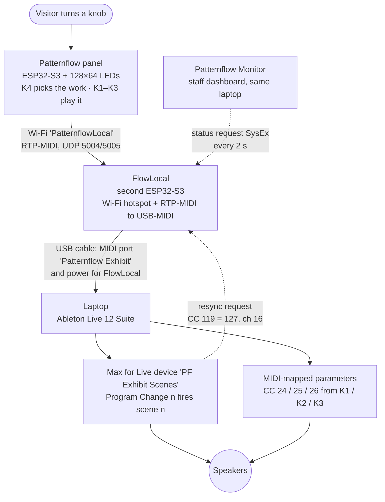
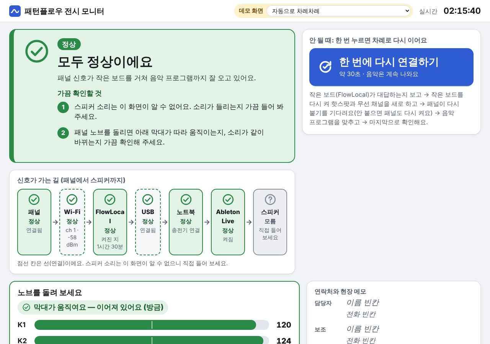
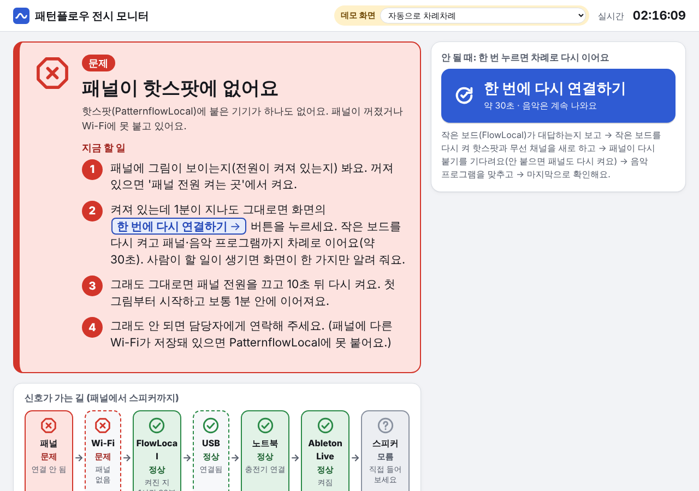

# Patternflow × Ableton Live — the *Anbu* exhibition setup (Seoul, 2026)

<p align="center">
  
</p>

<p align="center">▶ <a href="media/demo-720p.mp4"><b>Watch the full demo with sound</b></a> (85 s, portrait, MP4 · 21 MB)</p>

<!-- YOUTUBE: -->

<table>
  <tr>
    <td width="50%"></td>
    <td width="50%"></td>
  </tr>
  <tr>
    <td>At the show: visitors play the artists' works on the panel.</td>
    <td>The whole rig: panel, FlowLocal board (left, bare), laptop with Live.</td>
  </tr>
</table>

At ***Anbu — Asking After the Unseen*** (안부 — 보이지 않는 안부를 묻다), a group show of six visually impaired artists in Seoul (3–9 October 2026), one interactive corner let visitors *play* the artists' paintings, illustrations and sculptures as moving LED patterns on a [Patternflow](https://patternflow.work) panel. **One knob picks the work, the other three play it, and the sound follows the knobs**: every knob move also goes out as MIDI to Ableton Live, so the picture and the sound always come from the same knob position, and each work can be followed by ear as well as by eye.

The artists: **Bak Hwan** 박환 · **Choe Gyeong-eun** 최경은 · **Han Yeong-hui** 한영희 · **Heo Eun-bin** 허은빈 · **Jeong Eun-gyo** 정은교 · **Yu Jin** 유진. The exhibition was organised by **Ablind** (에이블라인드) and supported by the **Korea Arts Management Service** (KAMS, 예술경영지원센터). The patterns are drawn from the artists' works; the works themselves are the artists' and are not in this repository. [Full credits](#credits).

This repository is everything that ran there — the six patterns, the panel firmware, the firmware of a second board (FlowLocal), the Ableton Live set with its Max for Live device, and the staff monitor — written up so you can understand it in a minute and rebuild it in an afternoon.

> It is a worked example of what Patternflow + sound can do, not a product. A dedicated, free, lightweight Patternflow tool for sound/MIDI is planned separately.

<p align="center"></p>
<p align="center"><sub>Left to right, after works by Bak Hwan, Choe Gyeong-eun, Han Yeong-hui, Heo Eun-bin, Jeong Eun-gyo and Yu Jin — the six patterns at their opening knob positions, captured from <a href="patterns/preview.html"><code>patterns/preview.html</code></a> (open it in a browser to play them — no hardware needed).</sub></p>

**Contents** — [How it works](#how-it-works-in-one-minute) · [What you need](#what-you-need) · [Build it](#build-it-step-by-step) · [The Live set](#the-live-set-track-by-track) · [MIDI map](#midi-map) · [Switching](#how-switching-works) · [Without FlowLocal](#without-a-second-board) · [Monitor](#the-staff-monitor-optional-windows) · [First-run checklist](#first-run-checklist) · [Troubleshooting](#troubleshooting) · [Repository map](#repository-map) · [Credits](#credits) · [Licences](#licences)

---

## How it works in one minute



1. **The panel** runs the six artists' patterns, compiled into its firmware. **K4** steps through them (three detents per step); **K1–K3** change what the current pattern does. The panel remembers *one position per knob* and uses it twice: to draw (every pattern reads it) and to play (it is sent as a MIDI CC). So the picture and the sound can never drift apart.
2. **FlowLocal**, a second ESP32-S3 board, opens the Wi-Fi hotspot the panel joins and receives the panel's network MIDI (RTP-MIDI). It passes every message on, unchanged, to the laptop over USB, where it shows up as an ordinary class-compliant MIDI device called **Patternflow Exhibit**. The laptop needs no Wi-Fi and no network-MIDI driver.
3. **Ableton Live** gets a *Program Change* each time the pattern changes; a small Max for Live device fires the matching scene, so each work has its own sound. The knob positions arrive as *CC 24/25/26* and move filters, grain position, reverb, volume and so on through ordinary MIDI mappings (Ctrl-M / Cmd-M).
4. Only two things ever travel back from the laptop: Live's *resync request* ("send me the current pattern again"), and the staff monitor's status questions. Nothing reaches the panel.

<details>
<summary>The same signal path as the ASCII diagram in the Korean notes</summary>

```
 A visitor turns a knob
        │
        ▼
 ┌─ Patternflow panel ─────────────────────────────┐
 │ ESP32-S3, 128×64 LEDs.  Power: J4 screw         │
 │ terminal, 5 V only                              │
 │ K4 = switch pattern,  K1–K3 = pattern params    │
 │                         + MIDI CC               │
 └─────────────────────────────────────────────────┘
        │  joins Wi-Fi "PatternflowLocal"
        │  RTP-MIDI (UDP 5004 control / 5005 data)
        │  the panel invites 192.168.66.1
        ▼
 ┌─ FlowLocal ─────────────────────────────────────┐
 │ ESP32-S3-DevKitC-1 N16R8.  Power: laptop USB    │
 │ hotspot + RTP-MIDI → USB-MIDI relay             │
 │ answers the laptop monitor's status requests    │
 │ and commands (SysEx)                            │
 └─────────────────────────────────────────────────┘
        │  the DevKit's "USB" jack → laptop  (not the COM jack)
        │  USB-MIDI port name: "Patternflow Exhibit"
        ▼
 ┌─ Laptop (Windows 11) ───────────────────────────┐
 │ Ableton Live 12 Suite + Max 9                   │
 │ Max for Live device "PF Exhibit Scenes"         │
 │   Program Change n → fire scene n               │
 │   CC 24/25/26 → parameters mapped with Ctrl-M   │
 │ Patternflow Monitor (tools/monitor, staff view) │
 │   asks FlowLocal for status over the same port  │
 └─────────────────────────────────────────────────┘
        │  laptop audio output
        ▼
     Speakers
```
</details>

---

## What you need

| Part | What the show used | Notes |
|---|---|---|
| **Patternflow panel** | Patternflow v3.x board, ESP32-S3 DevKit (N16R8), 128×64 HUB75 LED matrix, four push-encoders K1–K4 | Build guide and hardware files: [engmung/Patternflow](https://github.com/engmung/Patternflow). **Power it through the J4 screw terminal (5 V) only, never through USB-C** — a v3.0 board powered over USB-C once ran fine for 20–30 minutes and then smoked at the connector. |
| **FlowLocal** (second board) | Bare **ESP32-S3-DevKitC-1 N16R8**, nothing attached | Needs 16 MB flash and 8 MB PSRAM (the N16R8 variant). Leave the USB-OTG solder jumper **open**; no USB stick, SD card, display or battery. No board? See [Without a second board](#without-a-second-board). |
| USB cable | DevKit **USB** jack → laptop | The DevKitC-1 has two USB jacks. **USB** is the ESP32-S3's own (native) USB; **COM** (labelled *UART* on some boards) goes through a USB-serial chip (CH343 or CP210x). On the show's board USB was on the left, COM on the right. The USB cable carries MIDI and powers FlowLocal; a second cable on COM is handy for flashing and the serial log. |
| **Laptop** | Windows 11 with Windows MIDI Services | Live, the Max device and FlowLocal's USB-MIDI are not Windows-specific; macOS was not tested. The staff monitor and the `.bat` helpers are Windows-only. Windows MIDI Services let Live and the monitor open the same MIDI port at once; with an older MIDI driver a USB port opens in **one program at a time** (see [the monitor](#the-staff-monitor-optional-windows)). |
| **Ableton Live 12 Suite**, 12.4 or newer | Live 12.4 Suite (Max for Live, Max 9, comes with it) | The set was saved by Live 12.4. Suite is needed: it uses Meld, Collision, Corpus and two Max for Live devices (Granulator III and the exhibition's own device); in Intro or Standard the scene device does not load. Max for Live is part of Suite — nothing else to install. No licence? Ableton's free 30-day Suite trial should do (not tested with this set). |
| Ableton packs | Mood Reel, Drone Lab, Granulator III | The set's three samples and Granulator III come from these packs (Live's browser → Packs). See [Samples](#samples). |
| Speakers | on the laptop's audio output | |
| Build tools | Python 3, git, `pip install platformio esptool python-rtmidi`; on Windows, Git Bash | PlatformIO downloads the ESP32 toolchains on the first build (several hundred MB). esptool 5 spells its commands `write-flash` / `erase-flash`, as below. python-rtmidi is for the MIDI tools and the monitor. |
| Optional | a phone (for the boards' web pages); a virtual MIDI port to test Live without hardware ([loopMIDI](https://www.tobias-erichsen.de/software/loopmidi.html) on Windows, the IAC Driver on macOS) | |

**Versions in this repo** (what ran at the show):

| Piece | Version |
|---|---|
| Panel firmware | [Patternflow](https://github.com/engmung/Patternflow) at commit `4d264d5` (2026-09-17, core v3.10.3) + [`firmware/panel-exhibit-2026.patch`](firmware/panel-exhibit-2026.patch) = the exhibition branch; it reports `variant: "exhibit"`, `variantVersion: "v0.1.0"`. PlatformIO `espressif32@7.0.1`. |
| FlowLocal firmware | [`firmware/flowlocal/`](firmware/flowlocal/), the exhibition branch `exhibit-2026` at `c6360dc` (`flx-mon3`), PlatformIO env `exhibit`: pioarduino platform 55.03.38, AppleMIDI 3.5.0, MIDI Library 5.0.2. |
| Live set | [`set Project/set.als`](set%20Project/set.als), saved by Ableton Live 12.4 (Suite) |
| Max for Live device | [`PF Exhibit Scenes.amxd`](set%20Project/Presets/MIDI%20Effects/Max%20MIDI%20Effect/) with [`pf_exhibit_scenes.js`](ableton/pf-exhibit-scenes/pf_exhibit_scenes.js); source patch [`pf_exhibit_scenes.maxpat`](ableton/pf-exhibit-scenes/pf_exhibit_scenes.maxpat) |

---

## Build it, step by step

Plan an afternoon: about an hour for the two firmware builds (most of it downloads), an hour for Live and its packs, and the rest for the [first-run checklist](#first-run-checklist). The full detail of every step, with the measurements from the show, is in the [install and operations notes](docs/setup-notes.en.md).

### 0. Get the repo and pick a hotspot password

```bash
git clone https://github.com/Patternflow-lab/patternflow-exhibition-2026
cd patternflow-exhibition-2026
```

Choose one Wi-Fi password (8–63 characters, **not** `patternflow` — the FlowLocal build refuses that one). The hotspot name stays **`PatternflowLocal`**. You will write the same name and password into *both* boards' secrets files below; they are compiled into both images, so never publish those `.bin` files.

> **Non-ASCII paths (Windows).** The ESP32 linker cannot write under a folder name with non-ASCII characters (the show laptop's path was Korean). If your user folder or this repo's path has any, point the build folders at a plain path, as shown below.

### 1. FlowLocal: build and flash

FlowLocal's own docs: [`EXHIBIT.md`](firmware/flowlocal/EXHIBIT.md) (this build), [`README.md`](firmware/flowlocal/README.md) and [`BUILD.md`](firmware/flowlocal/BUILD.md) (the general appliance and its case).

```bash
cd firmware/flowlocal
cp flowlocal_secrets.example.h flowlocal_secrets.h
#   edit flowlocal_secrets.h:  FL_AP_SSID "PatternflowLocal"   FL_AP_PASS "<your password>"
python -m platformio pkg install -e exhibit      # first time only
python -m platformio run -e exhibit
python tools/check_exhibit_image.py              # checks the image (see the note below)
```

- `flowlocal_secrets.h` is **not** covered by a `.gitignore` in this repo — do not commit it.
- On Windows the first build must run in **PowerShell or cmd**, not Git Bash: the toolchain installer stops with `MSys/Mingw is not supported`. If the path is non-ASCII, first set `PLATFORMIO_PLATFORMS_DIR`, `PLATFORMIO_PACKAGES_DIR` and `PLATFORMIO_BUILD_DIR` to folders on a plain path.
- Output: `.pio/build/exhibit/firmware.bin` and `firmware.factory.bin` (bootloader + partitions + app, written at `0x0`), or the same under `$PLATFORMIO_BUILD_DIR/exhibit/`.
- `check_exhibit_image.py` looks for the placeholder password `YOUR_PF_WIFI_PASS` that replaced the real one in this public copy, so with your own password its *exhibit AP password* line reports `FAIL`. That line is expected; every other line must pass (or change `EXHIBIT_PASS` in your copy of the script to your password).
- Optional host test, no board needed: `python tools/check_exhibit_bridge.py` (needs a C++ compiler; `pip install ziglang` provides one — see EXHIBIT.md "Host test").

**Flash** — plug the **COM** jack (right) into your computer, find its port (`COMx` / `/dev/ttyUSB0`), and erase on the first flash:

```bash
python -m platformio run -e exhibit -t erase_upload --upload-port COMx
#   or, with esptool:  python -m esptool --chip esp32s3 --port COMx erase-flash
#                      python -m esptool --chip esp32s3 --port COMx --baud 921600 write-flash 0x0 .pio/build/exhibit/firmware.factory.bin
```

Only the native **USB** jack plugged in? Hold **BOOT**, press and release **RST**, release **BOOT**: a new serial port appears; flash to it, then **press RST once** — the board stays in download mode until you do. (FlowLocal's `EXHIBIT.md` says the USB jack cannot flash; that holds only without this button sequence. The show's board was flashed this way.)

**Check** — plug the **USB** jack into the laptop. Within a few seconds a MIDI port **Patternflow Exhibit** appears: from the repo's top folder (`cd ../..`), `python tools/midi_monitor.py --list` lists it. Twelve seconds after power-up — on purpose, so a panel from before the restart lets go — the hotspot **PatternflowLocal** appears; join it with a phone and open `http://192.168.66.1/` for FlowLocal's status page. On the very first boot after an erase an open network `ESP_xxxxxx` shows for about a second first; that is normal.

### 2. Panel: build and flash

The panel firmware is the public Patternflow source at `4d264d5` plus the exhibition patch. **Clone it inside this repo, as `patternflow/`** — the patch compiles the six patterns straight from this repo's [`patterns/`](patterns/) folder (`#include "../../../../../patterns/…"`), and `.gitignore` already leaves `patternflow/` out.

```bash
cd ../..                                  # back to this repo's top folder
git clone https://github.com/engmung/Patternflow patternflow
cd patternflow
git checkout 4d264d5
git apply ../firmware/panel-exhibit-2026.patch
cp ../firmware/patternflow_secrets.example.h firmware/patternflow/patternflow_secrets.h
#   edit it:  PF_WIFI_SSID "PatternflowLocal"   PF_WIFI_PASS "<the same password>"
PF_BUILD_DIR=$HOME/pf-build ./firmware/bundles/build.sh exhibit      # Git Bash on Windows
```

- `build.sh exhibit` copies the exhibition build settings in, builds with PlatformIO and takes them out again. **Do not run `pio run` in `firmware/patternflow` yourself** — that builds plain Patternflow without the exhibition features.
- The build stops on purpose if `patternflow_secrets.h` is missing (`PF_WIFI_BUILTIN_ONLY needs the network's PF_WIFI_SSID …`). It ends with `NOTE: built WITH patternflow_secrets.h`.
- Output: `$PF_BUILD_DIR/firmware/firmware.bin`, with `bootloader.bin` and `partitions.bin` beside it. `PF_BUILD_DIR` must be a plain-ASCII path (the default is `$HOME/pf-build`).
- The comment in `patternflow_secrets.example.h` mentions "a phone hotspot"; at the show the hotspot was FlowLocal's.

**First flash, over USB.** Take the ESP32-S3 DevKit off the panel board (as in the Patternflow build guide) and plug its native USB jack into your computer — it flashes without pressing any button. Always give `--port`, especially when FlowLocal is plugged in too. `boot_app0.bin` comes with PlatformIO, in `~/.platformio/packages/framework-arduinoespressif32/tools/partitions/`.

```bash
B=$HOME/pf-build/firmware
BOOT_APP0=~/.platformio/packages/framework-arduinoespressif32/tools/partitions/boot_app0.bin
export PYTHONUTF8=1                       # esptool 5 on a non-English Windows console
python -m esptool --chip esp32s3 --port COMx erase-flash
python -m esptool --chip esp32s3 --port COMx --baud 921600 write-flash \
  0x0 "$B/bootloader.bin" 0x8000 "$B/partitions.bin" 0xe000 "$BOOT_APP0" 0x10000 "$B/firmware.bin"
```

Later updates can keep the settings: `write-flash 0xe000 "$BOOT_APP0" 0x10000 "$B/firmware.bin"` (keep `boot_app0` — a board that once took an over-the-air update boots from the second slot otherwise). Or update over Wi-Fi from a computer that has *briefly* joined the hotspot: `PF_BUILD_DIR=$HOME/pf-build ./firmware/bundles/build.sh exhibit flash <panel-ip>` (the panel's address is on FlowLocal's status page). Afterwards remove `PatternflowLocal` from that computer's saved networks, or it will rejoin and take one of the hotspot's three places.

**Check** — the panel boots into pattern 1 (BAKWAN), with no caption. Its serial log (DevKit USB jack, 115200) shows `[EXHIBIT] 6 patterns at 1..6, default 1 (BAKWAN), captions off`, then `[WiFi] connecting to "PatternflowLocal"`, and within seconds of FlowLocal's hotspot coming up `[MIDI] rtp session joined by "…"`. From a phone on the hotspot, `http://<panel-ip>/api/status` must show `"variant":"exhibit"` and, inside `"midi"`, `"outLaneAbs":true` and `"locked":true` — without those it is not the exhibition image.

### 3. Wire it up

- Panel: 5 V into **J4** only. Nothing in the DevKit's USB port during the show.
- FlowLocal: its **USB** jack (left) into the laptop. Pick one laptop USB port and mark it with tape: a different port can make Windows see a "new" device (`2- Patternflow Exhibit`), and Live then needs its MIDI settings switched on again.
- The laptop does **not** join the hotspot. The hotspot takes three devices at most — panel, an operator phone, one spare — so switch off phones you are not using.

### 4. Open the Live set

<details>
<summary><b>New to Live? The two minutes you need first</b></summary>

- **Settings**: Options → Settings (Windows) or Live → Settings (macOS), `Ctrl`/`Cmd` + `,`.
- **Session View** (the `Tab` key switches to it) is a grid: each **column is a track**, each **row is a scene**. A *scene* launches every clip in its row at once; its ▶ buttons are in the Main track's column on the right.
- Each track's **In/Out** section (View → In/Out) sets **MIDI From** (where the track's MIDI comes from, and which channel), **MIDI To** (where it sends MIDI) and **Monitor**. *Monitor In* means the track always plays its live input; *Auto* only when the track is armed.
- Click a track's name to see its devices in the **Device View** at the bottom. The **PF Exhibit Scenes** device is on the track `1-MIDI`, with two status lines and the Autostart and Resync buttons.
- A **Program Change** is a MIDI message that carries just a number — here, the pattern number. A **CC** (Control Change) carries a controller number and a value 0–127 — here, a knob position.
- A **Max for Live device** is a small program running inside Live Suite. The one in this set is already built and *frozen* (its code is inside the `.amxd` file): **you do not need to open Max**.
- **MIDI Map Mode** (`Ctrl`/`Cmd` + `M`) ties a knob's CC to a parameter; mapped parameters turn blue. **Takeover Mode** (in Settings) decides what happens when a knob's value and the parameter's value differ.
</details>

1. Install the packs **Mood Reel**, **Drone Lab** and **Granulator III** (Live's browser → Packs), then open `set Project/set.als`. If Live reports missing files, see [Samples](#samples).
2. **Settings → Link, Tempo & MIDI**:

   | Port | Track | Sync | Remote |
   |---|---|---|---|
   | In: **Patternflow Exhibit** | **On** | Off | **On** |
   | Out: **Patternflow Exhibit** | **On** (the resync request leaves this way) | Off | Off |

   **Takeover Mode: None.** The panel's CC is always the knob's absolute position, so with *None* the same knob position always gives the same sound. (Pick-Up would ignore the knob until it crosses the parameter; Value Scaling would leave Live and the panel out of step until a knob reaches its end.) These settings belong to the computer, not the set, and each Live update starts a new settings folder — check them again after updating Live.
3. **Audio**: Settings → Audio, choose your output device and sample rate. **Test the sound before the panel is involved**: click the ▶ of the *second* scene from the top (Live labels it 2; it is pattern 1, BAKWAN). You should hear a slow granular drone. Stop it with the ■ *Stop All Clips* button. Silence? Check the output device (Settings → Audio has a *Test Tone*) and the packs. The top scene (0) and the bottom one (7) are empty on purpose, and scene 4 only sounds while the lizard walks on the panel. On the Windows show laptop Live ran through **FlexASIO** (Driver Type ASIO, 48 kHz, 480-sample buffer) — the laptop's Realtek ASIO driver crashed Live twice, and MME/DirectX had 96 ms of latency.
4. Click the **control track** `1-MIDI` and set its In/Out: MIDI From **Patternflow Exhibit / All Channels** (the shared set has *Ch. 1*; change it), MIDI To **Patternflow Exhibit / Ch. 16**, Monitor **In**. On it sits only the **PF Exhibit Scenes** device. Its lower status line reads `ready - scenes 0-7`; it changes to `fired hh:mm:ss` once a scene is fired — by FlowLocal's answer if the panel is already connected, by K4, or by Autostart.
5. On the device, click **Autostart** so it lights (the shared set has it off), then save the set (`Ctrl`/`Cmd` + `S`). With Autostart on, the set plays pattern 1's scene and starts the transport 1.5 s after it opens — what an unattended laptop needs. The other saved differences are in [Before you play the set](#before-you-play-the-set).
6. Turn K4 on the panel: the scene changes. Turn K1–K3: the sound changes with the picture.

The full Live and Max guide — including how to rebuild the `.amxd` from the `.maxpat` if you change the device — is [`ableton/README.en.md`](ableton/README.en.md).

### 5. Optional: the staff monitor

On the Windows laptop: `python -m pip install python-rtmidi`, then double-click `tools/monitor/start_monitor.bat` (or the top-level `패턴플로우 모니터 열기.bat`, "Open Patternflow Monitor"). See [The staff monitor](#the-staff-monitor-optional-windows).

---

## The Live set, track by track

Tempo 80 BPM, Global Launch Quantization **None** (a scene changes the moment K4 does). Scene *n* plays the clip in row *n* of track *n*; every other track's slot in that row is empty, so the other tracks stop. The track names are Korean words for what each pattern shows.

| Scene = Program Change | Pattern (artist) | Track | What plays | Devices |
|---|---|---|---|---|
| 0 | Origin (Patternflow's built-in pattern, only reachable from the panel's web console) | — | nothing (empty row) | — |
| 1 · *boot and idle pattern* | BAKWAN (Bak Hwan 박환) | `1.은행나무` "Ginkgo tree" | one long held C3 | **Granulator III** on *Scratching Velvet Texture* (Mood Reel) → Utility |
| 2 | CHOEGYEONGEUN (Choe Gyeong-eun 최경은) | `2.괘짝` "Wooden chest" | one long held C3 | **Granulator III** on *Solfeggio Gong 3* (Drone Lab) → **Corpus** (preset *Loop Percussifier*) |
| 3 | HANYEONGHOE (Han Yeong-hui 한영희) | `3.산` "Mountain" | one long held C3 | **Simpler** on *Birds and Insects in Forest 02* (Mood Reel) → Amp → Utility → Auto Pan → Limiter |
| 4 | HEOEUNBIN (Heo Eun-bin 허은빈) | `4.도마뱀` "Lizard" | an empty one-bar clip; the sound is the panel's **footstep notes** live on MIDI channel 10 | **Drum Rack** with two **Collision** pads, C1 (36) and D1 (38) |
| 5 | JEONGEUNGYO (Jeong Eun-gyo 정은교) | `5.기하학` "Geometry" | a 32-bar melody clip (96 notes) | **Instrument Rack**, two chains: *Tiny Echoes* (Arpeggiator → **Drift**) and *Dream Keys* (**Wavetable** → Delay → Reverb) |
| 6 | YUJIN (Yu Jin 유진) | `6.물고기` "Fish" | one long held C3 | **Meld** → Auto Filter → Reverb (preset *Arena Tail*) |
| 7 | — | — | nothing (spare row) | — |

Also in the set: return **A-Reverb** (Reverb) and return **B-Delay** (Delay, preset *Dotted Eighth Note*, not used by any send), and the control track **`1-MIDI`** with the **PF Exhibit Scenes** device (it also holds an empty clip in row 5, which does nothing).

### Samples

All three samples, and Granulator III itself, are from Ableton packs: *Scratching Velvet Texture* and *Birds and Insects in Forest 02* from **Mood Reel**, *Solfeggio Gong 3* from **Drone Lab**. The copies the show laptop kept inside the project (`set Project/Samples/Imported/`) are not in this repo. With the packs installed Live should find the originals; if it reports them missing, use the File Manager's search, or drop any sound of your own into Granulator III (tracks 1–2) or Simpler (track 3) — the mappings stay.

### Before you play the set

These are saved in `set.als` as shared, and differ from what the Korean guide recommends. The file is published as it ran, untouched; change them in Live and save. Step 4 above already covers the first two.

| In the set as shared | The guide's setting | Why it matters |
|---|---|---|
| PF Exhibit Scenes **Autostart off** | **On** for the show | With Autostart on, the set fires the Start PC scene (1) and starts the transport 1.5 s after it opens — needed for an unattended laptop. |
| Control track MIDI From **Patternflow Exhibit / Ch. 1** | **All Channels** | Program Changes (channel 1) get through either way. Only the device's *Alt CC* fallback reads FlowLocal's channel-16 mirror, and Ch. 1 filters it out. |
| Tracks 1, 2, 3, 5, 6: MIDI From **All Ins / Ch. 1**, Monitor Auto | **No Input** | Not harmless: selecting one of these tracks can arm it (Live arms the selected MIDI track when *Arm Exclusive* is on), and the knob-press notes 60–62 then play its instrument. Set them to *No Input*. **Leave track `4.도마뱀` as it is** — All Ins / **Ch. 10**, Monitor **In**: it is the footstep track. (The Korean guide describes the footsteps on a separate track; the shared set plays them on scene track 4 itself.) |
| Scenes have **no names** | named after the patterns | The table above is the order. Name them if you like. |

The status line says `scenes 0-7` (the set has 8 scenes); the Korean guide shows `0-6` from a 7-scene version.

---

## MIDI map

### What travels between the boxes

| From → to | Message | Channel | Number / value | When |
|---|---|---|---|---|
| Panel → Live | **Program Change** | 1 | *n* = pattern: 0 Origin, 1–6 the artists. *n* is the raw data byte (pattern 1 = `C0 01`); software that numbers programs 1–128 calls it *n* + 1 | every pattern change (K4, idle return, boot, web console); again whenever the panel's network session (re)connects |
| Panel → Live | **Control Change** | 1 | **CC 24 / 25 / 26** = K1 / K2 / K3 position, `round(position × 127)` | on every change, at most one per knob per 50 ms; 64 (middle) at boot and after idle return; sent again right after the Program Change when a session connects |
| Panel → Live | Note on / off | 1 | **60 / 61 / 62** velocity 127 = K1 / K2 / K3 pressed / released | knob presses (not used by this set) |
| Panel → Live | Note on / off | **10** | **36 / 38**, alternating, velocity 100, note-off after 40 ms | HEOEUNBIN only: one note each time the lizard's foot lands, 3 × Speed per second (≈ every 0.47 s at K3's middle) |
| Panel → Live | — | — | K4 sends no MIDI of its own | only the Program Change of the new pattern |
| FlowLocal → Live | **CC 118** (program mirror) | 16 | value = the same *n* | right after every Program Change FlowLocal passes on or re-sends; read only by the device's *Alt CC* fallback |
| FlowLocal → Live | re-send | 1 / 16 | Program Change *n*, CC 118, then the last CC 24/25/26 | when Live asks (resync), when USB reconnects or the laptop wakes, when a Program Change could not be delivered, or from the status page button *Send current pattern to Live* |
| Live → FlowLocal | **CC 119 = 127** (resync request, bytes `BF 77 7F`) | 16 | | the device sends it 0.5 s after the set loads and when you press **Resync** |
| Monitor → FlowLocal | SysEx `F0 7D 50 46 …` | — | status request every 2 s; commands only on a button press | see [`tools/monitor/README.en.md`](tools/monitor/README.en.md) |

FlowLocal throws away everything else that comes from the laptop, and never sends anything to the panel.

**The knob position** (K1–K3): one number per knob, 0 to 1, in 32 detents end to end (about one and a half turns), stopping at both ends. It drives the picture — parameter = low end + position × range of whatever the pattern defines — and the sound, CC = `round(position × 127)`. Switching pattern does not move it (no CC is sent); the new pattern simply opens at the same knob positions. The panel's own `/midi` page settings (sensitivity, relative mode) are not used for K1–K3 in this build. The full rule set is in `docs/midi-spec.md` of the patched Patternflow tree (spec 1.5, `PF_MIDI_OUT_LANE_ABSOLUTE`).

### What each knob does — picture and sound

Each knob has the same role in every pattern — **K1 = how much, K2 = colour or space, K3 = speed** — and its CC is mapped in Live to that pattern's track. The Live mappings are global (CC 24 moves *all* its targets on all tracks at once), but only the playing track is heard. Ranges are the Min → Max of each mapping as saved in the set; a reversed range (Min > Max) turns the parameter down as the knob goes up.

| Track | K1 · CC 24 | K2 · CC 25 | K3 · CC 26 |
|---|---|---|---|
| **1 · BAKWAN** — picture | foliage: sparse branches → dense gold | wind: light left wind → gale | speed |
| `1.은행나무` — sound | Granulator III *Filter Frequency* 7.5 kHz → 20 kHz | Granulator III *Position* 0 → 100 % | Granulator III *Transpose* −23 → +5 st |
| **2 · CHOEGYEONGEUN** — picture | the doors: closed (only light through the gap) → open | zoom: small → into the niche | flower speed |
| `2.괘짝` — sound | Granulator III *Filter Frequency* 6.6 kHz → 20 kHz | Corpus *Dry/Wet* 0 → 15 % | Corpus *LFO Rate*, full range |
| **3 · HANYEONGHOE** — picture | bloom: 2 clouds and small buds → 6 clouds and big open flowers | cloud size (and how far the stems sway) | wind |
| `3.산` — sound | *Send A* (to A-Reverb) −70 dB → 0 dB **and** Amp *Dry/Wet* 0 → 100 % | Utility *Gain* ≈ −15 dB → +5.5 dB | Auto Pan *Amount* 0 → 52 % |
| **4 · HEOEUNBIN** — picture | size: small → close-up of the head | backdrop: dark orange → six flowers | walking speed (the footstep notes follow it) |
| `4.도마뱀` — sound | *Send A* 0 dB → −70 dB (reversed) | — | — (the footstep rate is the panel's) |
| **5 · JEONGEUNGYO** — picture | state: scattered → assembled 3 × 3 | rotation: backwards → fast | drift speed |
| `5.기하학` — sound | crossfade: *Tiny Echoes* chain +6 → −27 dB while *Dream Keys* chain −39 → +6 dB | — | Arpeggiator *Rate* (free) 1000 ms → 104 ms |
| **6 · YUJIN** — picture | fish: 4 → 24 | current: calm cruising → a whirl across the screen | swimming speed |
| `6.물고기` — sound | Auto Filter *Frequency* 204 Hz → 20 kHz | Reverb (*Arena Tail*) *Dry/Wet* 0 → 29 % | Meld engine A and B *Oscillator Macro 1*, 0 → 44 % / 0 → 41 % |
| Return **A-Reverb** | Reverb *Dry/Wet* 100 % → 0 % (reversed) | — | — |

Every pattern opens with all three knobs in the middle (position 0.5, CC 64), so the **middle of each mapping range is the opening sound**. The Dream Keys preset inside track 5 also carries mappings on CC 0–7, which the panel never sends. Per-pattern parameter names and exact ranges: [`PATTERN_KNOBS.en.md`](PATTERN_KNOBS.en.md) and [setup notes §5](docs/setup-notes.en.md#5-replacing-an-artists-pattern).

**K1 and return A work together.** Return A's Dry/Wet is also on K1, reversed. On track 4 that agrees with its reversed send: less reverb as K1 rises. On track 3 it works against the send: at K1 = 127 a 0 dB send reaches a fully dry return, so track 3 gets louder and drier, and its reverb peaks around the middle. To make K1 on track 3 only add reverb, remove return A's mapping and leave its Dry/Wet at 100 %.

**To see or change the mappings**: press `Ctrl`/`Cmd` + `M` for MIDI Map Mode. Mapped parameters turn blue, and the Mapping Browser on the left lists them (channel 1, CC 24/25/26). To add one, click a parameter, turn the panel knob, then set Min and Max in the Mapping Browser (Min > Max reverses it). Press `Ctrl`/`Cmd` + `M` again to leave. Do not turn K4 while mapping. Keep both ends listenable — until the 3-minute idle return, the next visitor inherits whatever the last one left (a closed filter, say). Do not let scene tempo or clip automation move a mapped parameter: the same knob position would then sound different.

---

## How switching works

- **K4**: every three detents, the next pattern — 1 → 2 → … → 6 → 1 (backwards the other way). K4's press does nothing during the show (it only closes a failed-update card).
- The panel sends **Program Change n**. The **PF Exhibit Scenes** device fires `live_set scenes (n + Offset)`. Scenes count from **0 at the top**, the same way Program Change does — Live's own scene numbers start at 1, so name your scenes to avoid confusion.
- **Idle return**: three minutes untouched, the panel goes back to pattern 1 and puts K1–K3 back in the middle (sending CC 64 for each knob that was not there). Booting always starts at pattern 1.
- **After a restart** — the device asks FlowLocal for the current pattern 0.5 s after the set loads (the resync request); FlowLocal re-sends the Program Change and the last knob CCs, so Live picks up where the panel is. If the panel has sent nothing since FlowLocal started, nothing comes back and *Autostart* plays the Start PC scene instead. The device's **Resync** button sends the same request by hand.
- **Device settings**: Enable on · Autostart (see above) · Start PC 1 · Offset 0 · Thru **off** · Alt CC **off** · Alt CC number 118. Turn *Alt CC* on only if Live does not hand Program Changes to Max for Live devices — it did in the pre-show test (Live 12 Suite, 2026-09-19). The device code is commented in full: [`pf_exhibit_scenes.js`](ableton/pf-exhibit-scenes/pf_exhibit_scenes.js).

**Try the Live side without hardware.** Make a virtual MIDI port called `PF Test` (Windows: loopMIDI; macOS: Audio MIDI Setup → MIDI Studio → IAC Driver → *Device is online*, and use that port's name). In Live's settings: **In: PF Test** Track and Remote **on**, **Out: PF Test** everything **off** (a loop port echoes its output back in). On `1-MIDI`, set MIDI From to `PF Test` / All Channels and MIDI To to **No Output**. Then:

```bash
python tools/send_test.py --port "PF Test" pc 1            # fires scene 1
python tools/send_test.py --port "PF Test" pc 0 1 2 3 4 5 6 --interval 4
python tools/send_test.py --port "PF Test" sweep --cc 24 25 26
python tools/send_test.py --port "PF Test" demo --hold 8   # behaves like the panel
```

**When you are done, set `1-MIDI` back** to MIDI From Patternflow Exhibit / All Channels and MIDI To Patternflow Exhibit / Ch. 16 — otherwise the real panel will not change scenes. The full procedure, including the `dump` check that shows whether Program Changes reach the device: [`ableton/README.en.md`](ableton/README.en.md) §5.

`python tools/midi_monitor.py` prints everything that arrives on `Patternflow Exhibit` (or `--port`).

---

## Without a second board

The panel image from this patch is locked to one job: it joins only the network compiled into `patternflow_secrets.h`, and it always invites **192.168.66.1** to an RTP-MIDI session (the `/midi` page cannot change either). FlowLocal is the box that answers. Without it:

- **Give a computer that address.** On a Wi-Fi router whose network name and password match your secrets file, make the LAN `192.168.66.0/24`, move the router's own address off `.1` (to `192.168.66.254`, say) and give the laptop the fixed address `192.168.66.1`. Run an RTP-MIDI session on port 5004 that accepts invitations from anyone — Windows: [rtpMIDI](https://www.tobias-erichsen.de/software/rtpmidi.html), *Who may connect to me: Anyone*; macOS: Audio MIDI Setup → MIDI Network Setup, the same setting.
- **Or build the panel for your own host.** In *your* patched checkout, set `PF_MIDI_DEFAULT_HOST` in `firmware/bundles/exhibit/overrides.h` to your computer's address before building.
- In Live's settings, set the network session's **In** port to Track **on**, Remote **on**, and its **Out** port to Track **off**, Sync **off**, Remote **off**. Use that port in place of `Patternflow Exhibit` as the control track's MIDI From, and set its **MIDI To to No Output**. This port now leads straight to the panel, and the panel acts on any Program Change or CC 24–27 it receives (a Program Change picks a pattern; an incoming CC holds that knob for 5 s), so nothing may go back to it: no Remote feedback, no resync request, device Thru off.

What you lose: the program mirror (CC 118) and FlowLocal's answer to the resync request — the panel itself still re-sends the Program Change and K1–K3 whenever its session connects, so a reconnect still brings Live back in step. After restarting only Live, though, Live stays on the Start PC scene with the set's saved parameter values until someone turns K4 or a knob, or the panel's session reconnects. You also lose the staff monitor and FlowLocal's status page, which talk to FlowLocal. Live needs none of these to play.

---

## The staff monitor (optional, Windows)

<p align="center"> </p>
<p align="center"><sub>Demo mode, no hardware: <code>python tools/monitor/pf_monitor.py --demo</code>. Left: all good. Right: "the panel is not on the hotspot", with the steps to take.</sub></p>

A small Python program and a full-screen page for gallery staff on the show laptop. It shows the seven links **panel → Wi-Fi → FlowLocal → USB → laptop → Ableton Live → speakers**, says in plain words which one broke and what to do, and has one big button, **한 번에 다시 연결하기** ("Reconnect everything"), that restarts FlowLocal, waits for the panel (restarting it remotely if needed) and resyncs Live, step by step. It also reopens Live if it quits, and checks the laptop's sleep and USB power-saving settings.

- **Its screen is in Korean** (it was made for the show's staff). [`tools/monitor/README.en.md`](tools/monitor/README.en.md) gives every message and button with an English translation.
- Run: `python -m pip install python-rtmidi`, then `tools/monitor/start_monitor.bat` (or `python tools/monitor/pf_monitor.py --open`). `tools/monitor/install_startup.bat` adds it to Startup and the desktop. Contacts and the staff card's blanks go in `tools/monitor/config.json`.
- It shares the `Patternflow Exhibit` port with Live **only through Windows MIDI Services**, which the show laptop had. With an older MIDI driver a USB MIDI port opens in one program at a time: then do not add the monitor to Startup (it could take the port before Live does), and close Live before running the monitor, `midi_monitor.py` or `send_test.py`. The show runs fine without the monitor.
- Laptop power settings for a show (no sleep, no USB selective suspend, lid does nothing): run the top-level `노트북 전시용 전원 설정.bat` ("Laptop power settings for the exhibition") once; no admin rights needed.
- For staff, a one-page printable card: [`STAFF_CARD.en.md`](STAFF_CARD.en.md).

---

## First-run checklist

Do this once after setting up, and again after reflashing a board.

- [ ] FlowLocal on the laptop's marked USB port, by its **USB** jack. Live's MIDI port list shows **Patternflow Exhibit**.
- [ ] Twelve seconds after FlowLocal powers up, the hotspot `PatternflowLocal` is there; the panel joins it and FlowLocal's page (`http://192.168.66.1/`, from a phone) reads **Everything connected**.
- [ ] Panel `http://<panel>/api/status`: `"variant":"exhibit"`, and in `"midi"`: `"outLaneAbs":true`, `"locked":true`, `"rtpPeers":1`.
- [ ] Panel `/knobs` page: all four knobs **Direction = Normal**, **Edges per click = 4**; one clockwise detent raises the knob's Position by 1.
- [ ] Live: the device shows `ready - scenes 0-7`, then `fired hh:mm:ss`; **Autostart** on and the set saved (see [Before you play the set](#before-you-play-the-set)).
- [ ] K4, three detents: the pattern changes **and** the Live scene changes.
- [ ] K1–K3: the picture and the sound change together; at a knob's end both stop together. In MIDI Map Mode (`Ctrl`/`Cmd` + `M`) the mapped parameters show channel 1, CC 24/25/26.
- [ ] Pattern 4 (HEOEUNBIN): footstep sounds follow the lizard's steps; K3 changes their rate.
- [ ] Quit Live and reopen the set: it comes back on the panel's current pattern and knob positions.
- [ ] Leave everything for three minutes: back to pattern 1, knobs to the middle.
- [ ] Brightness: set it with the room lights as they will be (panel's web console → Brightness).
- [ ] The laptop is **not** on the hotspot (remove `PatternflowLocal` from its saved networks); operator phones' Wi-Fi off after checks.
- [ ] Captions (artist names on switching) are off by default; `http://<panel>/api/exhibit?caption=1` turns them on, `?caption=0` off.

Daily opening order: laptop (Live opens) → panel power. Closing: panel off → Live → laptop (FlowLocal turns off with the laptop's USB power).

---

## Troubleshooting

The [full troubleshooting table](docs/setup-notes.en.md#when-something-goes-wrong) covers every case seen at the show. The usual ones:

| Symptom | Likely cause | Fix |
|---|---|---|
| No sound at all, although the device says `fired …` | audio output device, transport stopped, a pack not installed, or an empty scene | Settings → Audio output and *Test Tone*; press Play; install Mood Reel / Drone Lab / Granulator III. Scenes 0 and 7 are empty on purpose; scene 4 sounds only while the lizard walks |
| FlowLocal build fails: `FL_AP_PASS is still the public default` | the example's password `patternflow` | set your own 8–63 character password in `flowlocal_secrets.h` |
| Panel build stops: `PF_WIFI_BUILTIN_ONLY needs the network's PF_WIFI_SSID in patternflow_secrets.h` | no secrets file in the patched tree | copy `firmware/patternflow_secrets.example.h` to `patternflow/firmware/patternflow/patternflow_secrets.h` |
| Linker cannot open its output file | the build folder's path is not plain ASCII | set `PF_BUILD_DIR` (panel) or the `PLATFORMIO_*_DIR` variables (FlowLocal) to a plain path |
| No `Patternflow Exhibit` in Live's port list | plugged into the **COM** jack, another USB port, or Windows kept an old device name | use the **USB** jack and the marked port; unplug, wait 5 s, plug back; if an old name shows, remove the device in Device Manager and replug |
| Picture changes with K4, the Live scene does not; FlowLocal page says `Panel not connected` | the panel is not in session: just powered on, hotspot full (3 devices), or an invitation got lost | wait a few seconds (the panel re-invites every second); turn off spare phones; power-cycle the panel |
| Picture and FlowLocal's *Current pattern* change, the Live scene does not | Live settings | In port **Track** on; control track MIDI From **Patternflow Exhibit** (not left on a test port), Monitor **In**; device **Enable** on; status line says `missing` → scene count / Offset |
| Scenes are one off | counting scenes from 1 | the top scene is 0 (Origin) |
| K1–K3 do not change the sound | no mapping, In port **Remote** off, or Takeover **Pick-Up** | map with Ctrl-M, Remote on, Takeover **None** |
| Picture and sound disagree (one stops at the end, the other does not) | not the exhibition image, or a knob slider on the panel's web console was used | check `/api/status` → `midi.outLaneAbs`; one detent on that knob brings them back together |
| Footstep notes silent | track `4.도마뱀` no longer on Monitor **In**, or its MIDI From not on Ch. 10 | Monitor **In**, MIDI From *All Ins* (or *Patternflow Exhibit*) / **Ch. 10** |
| Device stuck at `waiting for Live` | Max for Live did not start (Live is not Suite, or not authorised), or a rebuilt device cannot find its `.js` | the shared `.amxd` is already frozen: check that Live is Suite, then delete the device and drag `PF Exhibit Scenes.amxd` back in from `set Project/Presets/MIDI Effects/Max MIDI Effect/`. If you rebuilt the device, use **Freeze Device** in the Max editor (the snowflake) — not Live's *Freeze Track* ([`ableton/README.en.md`](ableton/README.en.md) §1) |
| After restarting FlowLocal, ~15 s without MIDI | it keeps the hotspot off for 12 s on purpose | wait; the panel rejoins within a few seconds after that |
| A phone cannot join the hotspot | three devices already on it | switch off other phones' Wi-Fi; make sure the laptop is not on it |
| Live crashes inside `rthdasio64.dll` (Windows) | the Realtek ASIO driver | use FlexASIO |

---

## Repository map

| Path | What it is |
|---|---|
| [`patterns/`](patterns/) | The six artist patterns: each folder has the JavaScript (Pattern Lab / simulator) and the `.h` the panel compiles. [`preview.html`](patterns/preview.html) plays them in a browser (its interface is in Korean). [`README.en.md`](patterns/README.en.md) |
| [`PATTERN_KNOBS.en.md`](PATTERN_KNOBS.en.md) | What K1–K3 (and the presses) do in each pattern, with exact ranges |
| [`firmware/panel-exhibit-2026.patch`](firmware/panel-exhibit-2026.patch) | Panel firmware: the exhibition branch as a patch on Patternflow `4d264d5` |
| [`firmware/patternflow_secrets.example.h`](firmware/patternflow_secrets.example.h) | Template for the panel's Wi-Fi secrets |
| [`firmware/flowlocal/`](firmware/flowlocal/) | FlowLocal firmware, full source (exhibition branch). Build: env `exhibit`, see [`EXHIBIT.md`](firmware/flowlocal/EXHIBIT.md) |
| [`set Project/`](set%20Project/) | The Ableton Live set and the PF Exhibit Scenes device (`Presets/MIDI Effects/Max MIDI Effect/`) |
| [`ableton/`](ableton/) | The device's source (`.maxpat` + `.js`) and the Live/Max/Windows-kiosk guide: [`README.en.md`](ableton/README.en.md) |
| [`tools/monitor/`](tools/monitor/) | The staff monitor: [`README.en.md`](tools/monitor/README.en.md) |
| [`tools/`](tools/) | `midi_monitor.py` (watch incoming MIDI), `send_test.py` (fake the panel), `test_pf_exhibit_scenes.js` (offline test of the device logic: `node tools/test_pf_exhibit_scenes.js`), `check_maxpat.py`, `check_exhibit_feature.py` (host test of the exhibition firmware features), `patterns/` (pattern host harness and tools) |
| [`firmware_images/`](firmware_images/) | Only the checksums of the show's images: the images themselves are not published (they contained the password). [`README.en.md`](firmware_images/README.en.md) |
| [`docs/setup-notes.en.md`](docs/setup-notes.en.md) | Full install and operations notes, translated from [`README.ko.md`](README.ko.md) |
| [`STAFF_CARD.en.md`](STAFF_CARD.en.md) | One-page card for gallery staff |
| `*.bat` (top level) | Windows helpers: `패턴플로우 모니터 열기.bat` opens the monitor; `노트북 전시용 전원 설정.bat` sets the laptop's power options |
| [`media/`](media/) | Demo video, GIF, photos, screenshots |

**Korean originals.** Every document was first written in Korean and the Korean files stay as they were: [`README.ko.md`](README.ko.md), [`ableton/README.md`](ableton/README.md), [`STAFF_CARD.md`](STAFF_CARD.md), [`PATTERN_KNOBS.md`](PATTERN_KNOBS.md), [`tools/monitor/README.md`](tools/monitor/README.md), [`patterns/README.md`](patterns/README.md), [`firmware_images/README.md`](firmware_images/README.md). Where code comments, tools or the Korean documents say `README.md`, they mean the Korean notes, now [`README.ko.md`](README.ko.md); `STAFF_CARD.md` means the Korean card.

**Not in this public copy:** the hotspot password (it reads `YOUR_HOTSPOT_PASSWORD` / `YOUR_PF_WIFI_PASS`; use your own), the prebuilt firmware images and the browser flasher (`flasher.html`) — build from source as above — the project's copies of the samples (use the packs or your own sounds), and the internal firmware backups (`backups/`). The running code is published exactly as it ran; where something in it does not fit a reader (a placeholder password in a check, a stale comment), this README says so instead of changing it.

---

## Credits

**The artists.** Each pattern is drawn from one artist's work. The works themselves — paintings, ceramics, sculptures — are the artists' and are not in this repository.

| Artist | Their work in the show (from the press) | The pattern | What the pattern shows |
|---|---|---|---|
| **Bak Hwan** 박환 | mountains and waterfalls in earth, thread, denim scraps and bark | 1 · `BAKWAN` | a tree with golden leaves in the wind |
| **Choe Gyeong-eun** 최경은 | ceramics that start from the six dots of braille | 2 · `CHOEGYEONGEUN` | a wooden chest whose doors open on flowers |
| **Han Yeong-hui** 한영희 | cosmos flowers, the road to Jebudo, the South Sea | 3 · `HANYEONGHOE` | a green mountain, clouds and flowers in the wind |
| **Heo Eun-bin** 허은빈 | clay shapes built and painted on canvas; the character 「우산토끼」 (*Umbrella Rabbit*) | 4 · `HEOEUNBIN` | a walking lizard (the gallery wall names a lizard among her characters) |
| **Jeong Eun-gyo** 정은교 | fish scales in hanji and silicone on black braille paper | 5 · `JEONGEUNGYO` | round shapes that drift together into a 3 × 3 grid |
| **Yu Jin** 유진 | afterimages of the sea in glow-in-the-dark paint | 6 · `YUJIN` | fish swimming in a sea current |

**The exhibition** — *안부 — 보이지 않는 안부를 묻다* / ***Anbu — Asking After the Unseen*** (*안부* is a greeting that asks how someone is): a group show of six visually impaired artists about nature and relationships, 40 works, 25 of them to be touched. 3–9 October 2026, free entry, Gallery 1, Modu Art Space (모두미술공간 전시실1), Seoul Square annex 5F, Jung-gu, Seoul. Organised by **Ablind** (에이블라인드), CEO **Yang Dream** (양드림). The exhibition was supported by the **Korea Arts Management Service** (KAMS, 예술경영지원센터) through its 2026 early-stage arts startup programme.

**Patternflow** by **Seunghun Lee** — the panel and its firmware, the pattern code (the files name `@engmung` as their author) and its C++ versions for the panel, the FlowLocal exhibition build, the Live set and the Max for Live device. FlowLocal grew out of the FlowLocal show appliance ([SimonePDA/flowlocal](https://github.com/SimonePDA/flowlocal)).

Artists' names are romanised approximately (Revised Romanization), always with the Korean beside them. The code names in `patterns/` are older, looser spellings (`bakwan` for 박환, `hanyeonghoe` for 한영희), kept because the firmware reads them. More in [`CREDITS.md`](CREDITS.md), with sources.

## Licences

Patternflow firmware and web code: **MIT**. Hardware, designs, documentation and patterns: **CC BY-SA 4.0**. The six patterns: **CC BY-SA 4.0, with credit to each artist** — the organiser allowed the exhibition's work to be used freely, and the creator publishes the patterns on these terms. The licence covers the pattern code and the pictures it draws, not the artists' original works. FlowLocal: **MIT**. Details for each folder: [`LICENSE.md`](LICENSE.md).

## Sources

- patternflow.work — *Played at Anbu*: <https://patternflow.work/inside/seunghun-anbu-seoul>
- 국민일보 (Kukmin Ilbo), 「시각장애 예술가 6인 '안부' 묻다…자연을 그린 작품 전시」: <https://www.kmib.co.kr/article/view.asp?arcid=9000018186>
- 소셜밸류 (Social Value), 「시각장애 예술가 6인전 '안부-보이지 않는 안부를 묻다' 개막」: <https://www.socialvalue.kr/news/view/1065593479086632>
- 매일일보 (Maeil Ilbo), 「시각장애 예술가 6인 전시 '안부' 10월 3일 개막」: <https://www.m-i.kr/news/articleView.html?idxno=1417179>
