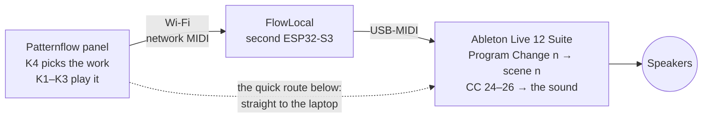

# Patternflow × Ableton Live at *Anbu* — six artists' works played as light and sound (Seoul, 2026)

  

<!-- YOUTUBE: https://youtube.com/shorts/zsmQVr4Ru4c -->

▶ <a href="https://youtube.com/shorts/zsmQVr4Ru4c"><b>Watch it with sound on YouTube</b></a> · or the <a href="media/demo-720p.mp4">85 s MP4</a> (portrait, 21 MB)

<table>
  <tr>
    <td width="50%"></td>
    <td width="50%"></td>
  </tr>
  <tr>
    <td>At the show: visitors play the artists' works on the panel.</td>
    <td>The whole rig: panel, FlowLocal board (left, bare), laptop with Live.</td>
  </tr>
</table>

At ***Anbu — Asking After the Unseen*** (안부 — 보이지 않는 안부를 묻다), a group show of six visually impaired artists in Seoul (3–9 October 2026), visitors played LED patterns made after the artists' works on a [Patternflow](https://patternflow.work) panel. **One knob picks the work, the other three play it, and the sound follows the knobs**: every knob move also goes to Ableton Live as MIDI, so what you see and what you hear come from the same knob.

The artists: **Bak Hwan** 박환 · **Choe Gyeong-eun** 최경은 · **Han Yeong-hui** 한영희 · **Heo Eun-bin** 허은빈 · **Jeong Eun-gyo** 정은교 · **Yu Jin** 유진. Organised by **Ablind** (에이블라인드), supported by the **Korea Arts Management Service** (KAMS, 예술경영지원센터). [Credits](#credits).

This repo holds everything that ran there: the six patterns, the panel firmware, the firmware of a second board (FlowLocal), and the Live set with its Max for Live device. It is a worked example of what Patternflow + sound can do, not a product; a free, lightweight Patternflow tool for sound/MIDI is planned separately.

After works by Bak Hwan, Choe Gyeong-eun, Han Yeong-hui, Heo Eun-bin, Jeong Eun-gyo and Yu Jin. Play them in a browser, no hardware needed: <a href="patterns/preview.html"><code>patterns/preview.html</code></a>.

## How it works

- A pattern change sends **Program Change *n***. A small Max for Live device in the set fires scene *n*, so each work has its own sound.
- Turning K1 / K2 / K3 sends **CC 24 / 25 / 26** on channel 1. Ordinary MIDI mappings in the set turn those into filter, grain, reverb and volume moves.
- At the show a second board, **FlowLocal**, ran the Wi-Fi hotspot and passed the MIDI to the laptop over USB, so the laptop needed no Wi-Fi and no driver. You can leave it out: the quick route below sends the MIDI straight to the laptop.

## What you need

- A **Patternflow** panel ([build it](https://github.com/engmung/Patternflow)). Power it through the **J4 screw terminal (5 V) only, never through USB-C**: a board powered over USB-C once smoked at the connector.
- A computer with **Chrome or Edge** and a USB data cable, to flash the panel.
- A laptop with **Ableton Live 12 Suite**, 12.4 or newer. It must be Suite: the set uses Max for Live and Suite's instruments. Live's free 30-day trial is Suite, but this set has not been tried with it. You also need the free packs **Mood Reel**, **Drone Lab** and **Granulator III**, and speakers.
- Network MIDI on the laptop. macOS has it built in; on Windows, install the free [rtpMIDI](https://www.tobias-erichsen.de/software/rtpmidi.html). The show ran on Windows 11; macOS was not tested.
- *Optional, as at the show:* a second board, an **ESP32-S3-DevKitC-1 N16R8**, for FlowLocal.

## Make it

### 1. Flash the panel in the browser

1. Open **[patternflow.work/flash](https://patternflow.work/flash)** in Chrome or Edge.
2. Take the ESP32-S3 DevKit off the panel board, as in the Patternflow build guide, and plug the DevKit's own USB jack into the computer.
3. Click the install button and pick the board's port. When it is done, give the panel your Wi-Fi network, the same one the laptop is on. Then put the DevKit back on the panel board.

There is nothing to install and nothing to build. Use the **Audio edition**, the one with network MIDI ([Patternflow editions](https://github.com/engmung/Patternflow/blob/main/docs/EDITIONS.md)). It sends the same messages as the show's panel: a Program Change on every pattern change, and CC 24–27 from the four knobs.

> The uploader installs Patternflow as it ships, not the show's own build. That build had the six patterns built in and K4 set to switch between them, and you build it from source: [full guide → Build it](docs/full-guide.en.md#build-it-step-by-step). Its ready-made images are not published, because they contained the venue's Wi-Fi password.

### 2. Connect the panel to the laptop

1. **On the laptop**, start a network MIDI session that lets anyone connect.
   - macOS: open *Audio MIDI Setup* → Window → *Show MIDI Studio* and double-click **Network**. Under *My Sessions* click **+**, tick the new session, and set *Who may connect to me* to **Anyone**.
   - Windows: open rtpMIDI and do the same: **+** under *My Sessions*, tick it, *Who may connect to me*: **Anyone**.
2. **On the panel**: in the laptop's browser open `http://patternflow.local/midi` (or `http://<panel-ip>/midi`). Make sure MIDI is on and click **Use this computer**. From now on the panel connects to the laptop every time it starts. If the laptop's address on the network changes, click it again.

Live sees the session by its name (*Session 1*, say) as a MIDI port.

### 3. Open the Live set

1. Install the packs: in Live's browser open **Packs** and download **Mood Reel**, **Drone Lab** and **Granulator III**. Then open [`set Project/set.als`](set%20Project/set.als).
2. **Settings → Link, Tempo & MIDI**: turn your session's **In** port **Track on** and **Remote on**. Leave its **Out** port all **off**. Set **Takeover Mode** to **None**.
3. Click the leftmost track, `1-MIDI`. Set its MIDI From to **your session / All Channels**, MIDI To to **No Output** and Monitor to **In**. Nothing may go back to the panel, because it acts on MIDI it receives.
4. Set MIDI From to **No Input** on the five tracks `1.은행나무`, `2.괘짝`, `3.산`, `5.기하학` and `6.물고기`. Leave `4.도마뱀` as it is.
5. On the **PF Exhibit Scenes** device (it is on `1-MIDI`), click **Autostart** so it lights. Then save the set.
6. Click the ▶ of the second scene from the top. If you hear a slow drone, the sound side works. Now change the pattern on the panel: Live's scene follows.

New to Live? A two-minute primer and every setting explained: [full guide → Open the Live set](docs/full-guide.en.md#4-open-the-live-set).

### 4. Play

**K4 changes the pattern, and Live's scene with it.** At the show, visitors played only the **other three knobs, K1–K3**. Each one changes the picture and the sound together, and each does something different in every pattern. Turn them and find out.

This is how it works on the show's build. On Patternflow as it ships, all four knobs play the pattern, and you change patterns the way you always do on your panel. Live follows either way: pattern *n* fires scene *n*, counting from 0 at the top. Scenes 1–6 hold the six works' sounds. Scenes 0 and 7 are empty. Scene 4 plays only the lizard pattern's footstep notes, which only the show's build sends.

Every knob, CC and range, picture and sound side by side: [full guide → MIDI map](docs/full-guide.en.md#midi-map).

## Going further

- **[The full guide](docs/full-guide.en.md)**: the setup exactly as it ran at the show, with both boards (FlowLocal too) built from source, every track and mapping, the staff monitor, a first-run checklist and troubleshooting.
- [Live and Max for Live in depth](ableton/README.en.md) · [what the knobs do in each pattern](PATTERN_KNOBS.en.md) · [the show's install and operations notes](docs/setup-notes.en.md) · [the gallery staff card](STAFF_CARD.en.md)
- Not in this repo: the ready-made firmware images (they held the Wi-Fi password) and the Live set's copies of its samples (they come from the packs above).
- **Korean originals.** Every document was first written in Korean, and the Korean files are kept as they were: [`README.ko.md`](README.ko.md) and the files without `.en`. Where code or the Korean docs say `README.md`, they mean `README.ko.md`.

## Credits

**The artists.** Each pattern was made after one artist's work. The works themselves are the artists' and are not in this repository.

| Artist | Their work in the show (from the press) | The pattern (K4 order) |
|---|---|---|
| **Bak Hwan** 박환 | mountains and waterfalls in earth, thread, denim scraps and bark | 1 · a tree with golden leaves in the wind |
| **Choe Gyeong-eun** 최경은 | ceramics that start from the six dots of braille | 2 · a wooden chest whose doors open on flowers |
| **Han Yeong-hui** 한영희 | cosmos flowers, the road to Jebudo, the South Sea | 3 · a green mountain, clouds and flowers in the wind |
| **Heo Eun-bin** 허은빈 | clay shapes built and painted on canvas; the character 「우산토끼」 (*Umbrella Rabbit*) | 4 · a walking lizard |
| **Jeong Eun-gyo** 정은교 | fish scales in hanji and silicone on black braille paper | 5 · round shapes that drift together into a 3 × 3 grid |
| **Yu Jin** 유진 | afterimages of the sea in glow-in-the-dark paint | 6 · fish swimming in a sea current |

**The exhibition.** *안부 — 보이지 않는 안부를 묻다* / ***Anbu — Asking After the Unseen*** (*안부* is a greeting that asks how someone is). A group show of six visually impaired artists about nature and relationships: 40 works, 25 of them to be touched. 3–9 October 2026, free entry, at Gallery 1, Modu Art Space (모두미술공간 전시실1), Seoul Square annex 5F, Jung-gu, Seoul. Organised by **Ablind** (에이블라인드), CEO **Yang Dream** (양드림), with support from the **Korea Arts Management Service** (KAMS, 예술경영지원센터) 2026 early-stage arts startup programme.

**Patternflow** by **Seunghun Lee**: the panel and its firmware, the pattern code (the files name `@engmung` as their author), the FlowLocal exhibition build, the Live set and the Max for Live device. FlowLocal grew out of the FlowLocal show appliance ([SimonePDA/flowlocal](https://github.com/SimonePDA/flowlocal)).

The English spellings of the artists' names are our own approximate romanisation, not confirmed by the artists; the Korean names are the reference. More, with sources: [`CREDITS.md`](CREDITS.md).

## Licences

- Patternflow firmware and web code: **MIT**.
- Hardware, designs, documentation and patterns: **CC BY-SA 4.0**.
- The six patterns: **CC BY-SA 4.0, with credit to each artist**. The organiser allowed free use of the exhibition's work. The licence covers the pattern code and the pictures it draws, not the artists' original works. Ready-made credit lines are in [`CREDITS.md`](CREDITS.md#how-to-credit-a-pattern-when-you-reuse-it).
- FlowLocal: **MIT**.

Artists or their representatives who want something changed can open an issue in this repository. Details for each folder: [`LICENSE.md`](LICENSE.md).
