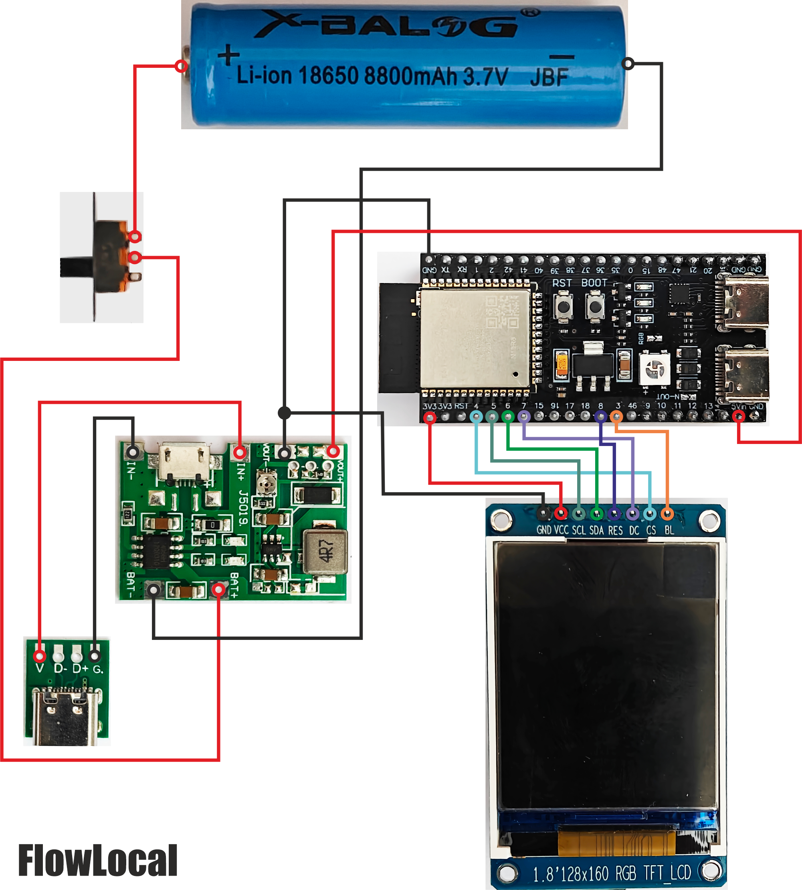
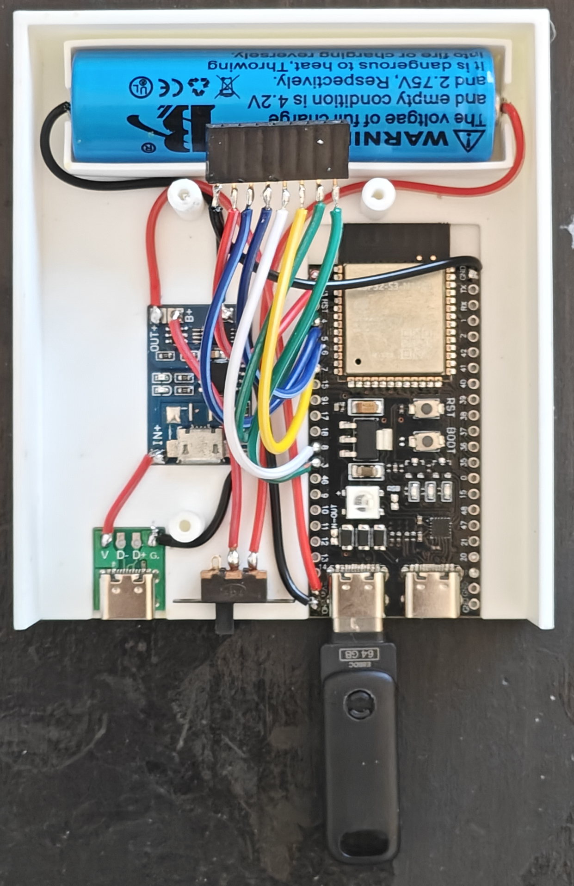
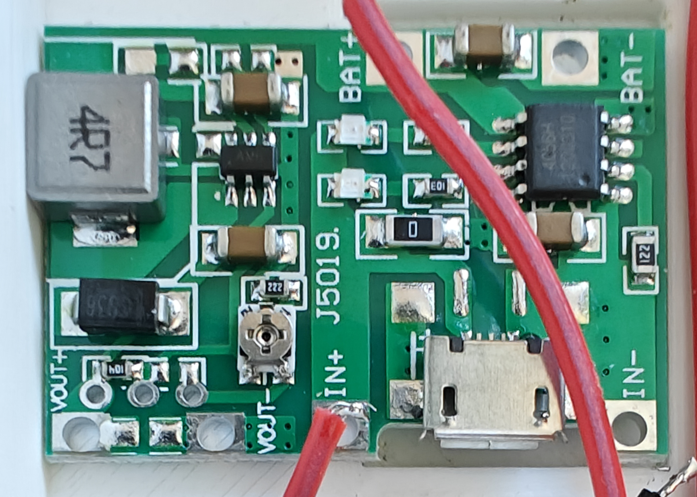
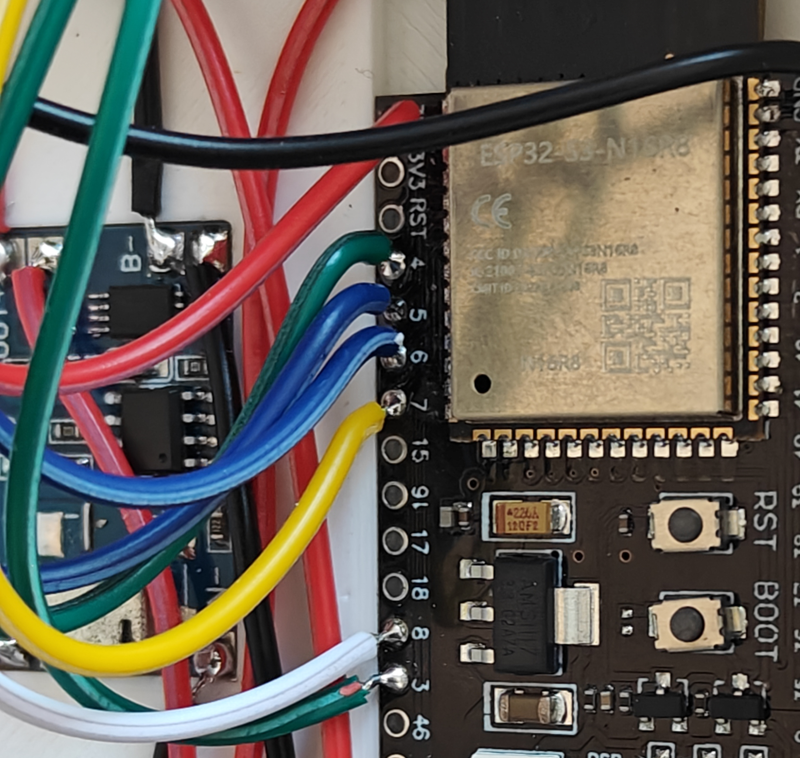
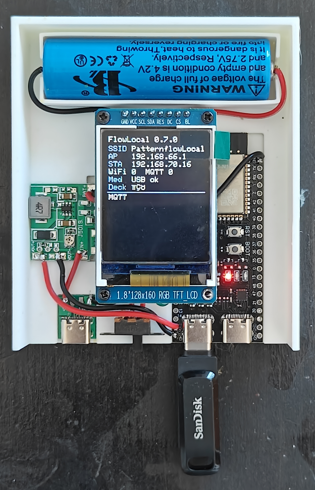
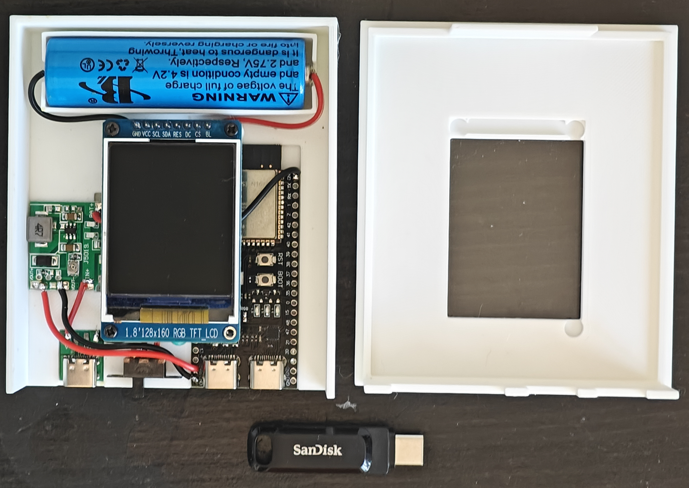
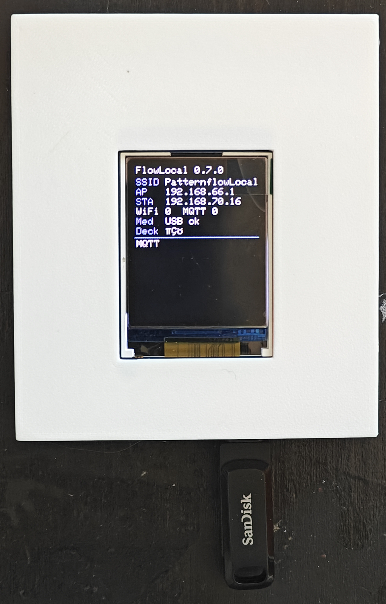

# FlowLocal — hardware build guide

How to assemble the portable FlowLocal appliance: 3D-printed case, ESP32-S3,
1.8″ ST7735 status display, 18650 pack, and a **J5019** charge + boost module.

Firmware and show setup live in [`README.md`](README.md) and [`KIT_README.md`](KIT_README.md).
This document is **hardware only**.

| Asset | Path |
|---|---|
| Build photos | [`build_pics/`](build_pics/) |
| Case STLs | [`3D_STL/FlowLocal_Case_bottom.stl`](3D_STL/FlowLocal_Case_bottom.stl), [`3D_STL/FlowLocal_TOPCase.stl`](3D_STL/FlowLocal_TOPCase.stl) |
| Schematic | [`build_pics/Schematics.png`](build_pics/Schematics.png) |

---

## Bill of materials

| Qty | Part | Notes |
|---:|---|---|
| 1 | ESP32-S3-DevKitC-1 **N16R8** (or YD N16R8 clone) | Two USB-C jacks labelled **COM** and **USB** |
| 1 | 1.8″ 128×160 TFT, **ST7735**, 3.3 V | Header: GND VCC SCL SDA RES DC CS BL |
| 1 | USB-C flash stick, **FAT32** | Plugs into the board’s **USB** jack (media) |
| 1 | 18650 Li-ion cell + holder | Protected cell preferred |
| 1 | **J5019** Li-ion charge + boost module | Set **VOUT ≈ 5.15 V** before wiring the ESP |
| 1 | USB-C **female** breakout (power only) | Case charge port → J5019 `IN+` / `IN-` |
| 1 | SPST slide switch | In series with **18650 + → J5019 `BAT+`**. Off = cell fully isolated |
| — | Wire, heat-shrink, solder | 22–26 AWG for logic; thicker for power |
| 1 | Printed case (bottom + top) | From the STLs above |

### Why J5019 (not a bare TP4056)

A simple charge board often passes **battery voltage** (~3.3–4.2 V) straight to the load. The DevKit’s **5V / VIN** pin feeds an onboard 3.3 V LDO (e.g. AMS1117) that needs ~4.5 V+ of headroom. Under Wi‑Fi + USB-stick load the rail dips and the board browns out.

The **J5019** charges the 18650 **and** boosts to a stable **5.15 V** on `VOUT`. That is what you want on the ESP32 **5V** pin. Initially we tried the standard smaller board and then we had to change it to the J5019. Some initial pics show that TP4056, please disregard that version. The wiring on the J5019 is, however, the same.

---

## Critical board prep (before the case)

### 1 — Close the USB-OTG jumper

Factory boards often leave this **open**. Then the **USB** jack has D+/D− but **no VBUS 5 V**, so the stick never mounts.

Close the **USB-OTG** jumper (solder blob or header + jumper) so **COM** and **USB** share VBUS.

| Jack | Role in this build |
|---|---|
| **COM** | Flash / serial (CH343). Optional tether to a PC. |
| **USB** | Mass-storage **host** for the FAT32 stick |

**Warnings**

- Do **not** plug a PC into **both** jacks with OTG closed (two 5 V sources shorted).
- Power for show use comes from the **J5019 → 5V pin**, not from a PC.
- Leave OTG **open** only if you need native USB device-mode on the **USB** jack (not this kit).

### 2 — Set J5019 output **before** connecting the ESP32

1. Connect a USB charge source to J5019 `IN` (or a lab supply on `IN+`/`IN-`).
2. Close the battery switch and connect a cell on `BAT+` / `BAT-` (the boost is fed from the cell).
3. Measure **VOUT+** to **VOUT−** with a multimeter.
4. Turn the trim pot until **VOUT = 5.10–5.20 V** (target **5.15 V**).
5. Only then wire `VOUT` to the ESP32.

---

## Schematic overview

The switch sits on **battery positive only**. Off isolates the cell from the J5019. There is **no** switch on `VOUT`.

### Power path (as built)

| From | To | Notes |
|---|---|---|
| Case USB-C `V` / `G` | J5019 `IN+` / `IN−` | Charge input only (no data required) |
| 18650 `+` | Switch → J5019 `BAT+` | Switch **off** = cell fully disconnected |
| 18650 `−` | J5019 `BAT−` | Always connected |
| J5019 `VOUT+` | ESP32 header **5V** | Boosted ~5.15 V, always wired |
| J5019 `VOUT−` | ESP32 **GND** | Common ground |

### Operating modes

| Switch | Case USB-C | What happens |
|---|---|---|
| **Off** | — | Cell isolated from the charger/boost. No charge. Boost has no battery, so the ESP is off. |
| **On** | Unplugged | Cell on `BAT±`. J5019 boosts ~5.15 V → ESP runs from battery. |
| **On** | Plugged in | Cell charges **and** boost still feeds the ESP. Charge and use at the same time. |

Charging **requires** the switch **on**. With the switch off, plugging in USB-C does not charge the cell.

Do **not** feed raw 18650 voltage into the ESP32 **5V** pin.

### TFT (3.3 V SPI)

Module pins left→right as silk: **GND · VCC · SCL · SDA · RES · DC · CS · BL**

| TFT | ESP32-S3 | Role |
|---|---|---|
| GND | GND | Ground |
| VCC | **3V3** | Power (**not** 5 V) |
| SCL | GPIO **5** | SPI SCK |
| SDA | GPIO **6** | SPI MOSI |
| RES | GPIO **8** | Reset |
| DC | GPIO **7** | Data / command |
| CS | GPIO **4** | Chip select |
| BL | GPIO **3** | Backlight |

These match firmware defaults in `src/fl_pins_display.h` (`flowlocal` USB+TFT build).

---

## Print the case

1. Print [`3D_STL/FlowLocal_Case_bottom.stl`](3D_STL/FlowLocal_Case_bottom.stl) (base).
2. Print [`3D_STL/FlowLocal_TOPCase.stl`](3D_STL/FlowLocal_TOPCase.stl) (lid with display window).
3. Suggested: PETG or ABS for venue use; PLA is fine for prototypes. 0.2 mm layers, supports only where needed on the bottom cutouts.

Bottom cutouts (left→right as assembled): **charge USB-C**, **power switch**, ESP32 **COM**, ESP32 **USB** (stick).

---

## Assembly order

Photos: [`build_pics/`](build_pics/). Use them as a wiring reference while you work.

### Step 1 — Dry-fit

Seat the 18650 holder (top), J5019 (left), ESP32 (right, USB ports toward the bottom openings), switch, and charge USB-C breakout. Confirm the stick clears the case when plugged into **USB**. The on/off switch needs to be **glued** to the 3D printed base to allow easy soldering of the wires. The other elements snap into position. Some PCBs might need some filing with sandpaper to remove the roughness of the sides; keep filing the sides until the fit is tight andthe module does not move.

### Step 2 — Power wiring
*Note: the 18650 battery poles can be soldered directly after cleaning well the soldering area with sandpaper. This allows quick soldering without overheating the battery. If you don't want to solder on the poles, you can get a 18650 battery with the metal tabs for easy and safer soldering.*

1. Solder 18650 negative **−** → J5019 `BAT−`.
2. Solder 18650 positive **+** → switch → J5019 `BAT+` (switch in series on the positive).
3. Solder case USB-C breakout `V`/`G` → J5019 `IN+` / `IN−`.
4. Solder J5019 `VOUT+` → ESP32 **5V** (no switch on this net).
5. Solder J5019 `VOUT−` → ESP32 **GND**.
6. Switch **on**, meter ESP32 **5V**–**GND** ≈ **5.15 V**. Switch **off**: cell isolated, ESP off.

### Step 3 — TFT header

Solder or crimp an 8-pin socket for the display (top of the bay). Wire to GPIO **3–8**, **3V3**, and **GND** as in the table above. Keep leads short; route under the display window.

### Step 4 — Seat the display

Plug the ST7735 into the socket. Confirm silk **GND…BL** matches your harness. Power up briefly: backlight should light; after firmware flash you should see the status UI.

### Step 5 — OTG, stick, lid

1. Confirm **USB-OTG** jumper is closed.
2. Insert the FAT32 stick in **USB** (not COM).
3. Fit the top case ([`FlowLocal_TOPCase.stl`](3D_STL/FlowLocal_TOPCase.stl)).

---

## First power-on checklist

| Check | Expect |
|---|---|
| Switch **on**, no charge cable | ESP boots from battery; TFT shows `FlowLocal …` |
| Stick in **USB** | Status line `Med USB ok` (after mount) |
| Switch **on**, case USB-C on a charger | Charge LED activity; cell charges while the ESP stays on |
| Switch **off** | Cell isolated; no charge; ESP off |
| Wi-Fi | SSID `PatternflowLocal` / pass `patternflow`, AP `192.168.66.1` |

Flash firmware over **COM** if needed (`flowlocal` + LittleFS) — see [`KIT_README.md`](KIT_README.md).

---

## Safety notes

- Use a **protected** 18650 or a holder with a protection PCB when possible.
- Switch **off** isolates the cell. Leave it off for storage/transport. Charge only with the switch **on**.
- Never reverse `BAT+` / `BAT−`.
- TFT **VCC = 3.3 V only** — 5 V will destroy many ST7735 modules.
- Do not short COM and USB 5 V sources with OTG closed.
- If the boost pot is turned too high (>~5.5 V), you can damage the DevKit regulator — always meter **before** connecting **5V**.

---

## Troubleshooting (hardware)

| Symptom | Likely cause |
|---|---|
| Stick never mounts / `Med USB -` | OTG jumper open; stick in **COM**; not FAT32; weak 5 V |
| Boots on USB cable to PC but not on battery | Boost not set / switch on wrong net / raw cell on **5V** |
| TFT backlight only, garbage / white | Wrong SPI pins; VCC on 5 V; bad RES/DC |
| Browns out when stick + Wi-Fi | VOUT too low or thin power wires; re-set **5.15 V** under load |
| Charge port does nothing | Switch **off** (cell isolated); `IN±` not soldered; charge cable data-only (rare) |

---

## Related

- Firmware flash + show workflow: [`KIT_README.md`](KIT_README.md)
- Software overview: [`README.md`](README.md)
- Wiring schematic: [`build_pics/Schematics.png`](build_pics/Schematics.png)
